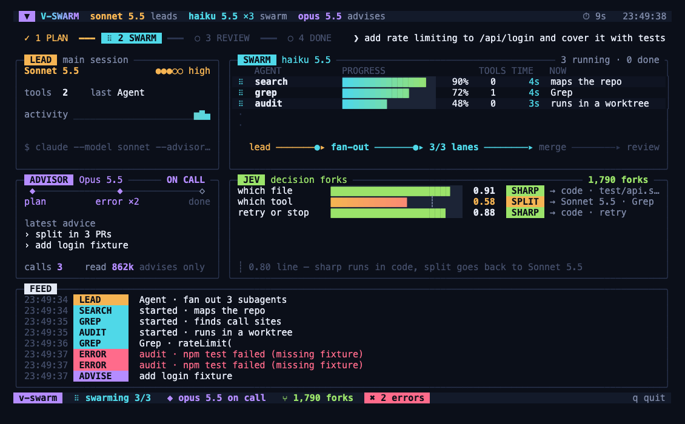

# v-swarm

จอ terminal แบบสดสำหรับดู Claude Code ทำงาน ว่าโมเดลหลักกำลังทำอะไร ส่งงานให้ subagent ตัวไหน แต่ละตัวคืบหน้าแค่ไหน
พร้อมแสดงการตัดสินใจของ Jev และคำแนะนำจาก advisor



```bash
bun install
bun src/cli.ts demo                      # ดูตัวอย่าง ไม่เรียก API
bun src/cli.ts run "หาว่าโปรเจคนี้ใช้ auth ที่ไหนบ้าง" --model sonnet -- --allowedTools "Agent Read Grep Glob"
```

ขนาด terminal ที่ต้องใช้คือ 120×36 กด `q` เพื่อออก

## หน้าจอ

- **แถบบน** ชื่อโมเดลที่ทำงานอยู่ เวลาที่ใช้ และราง phase `PLAN → SWARM → REVIEW → DONE` ไฮไลต์ขั้นที่กำลังทำ
- **LEAD** โมเดลหลัก, effort, จำนวน tool, กราฟ activity ย้อนหลัง 1 นาที
- **ADVISOR** จุดที่ advisor ถูกเรียก (plan / error ×2 / done) และคำแนะนำล่าสุด ถ้าไม่มี advisor จะเป็น SESSION แสดงสถิติแทน
- **SWARM** subagent เป็นแถว (สูงสุด 5 แถว) พร้อมแถบความคืบหน้า, tool, เวลา และงานที่ทำอยู่ ด้านล่างเป็นเส้น flow lead → fan-out → lanes → merge → review
- **JEV** การตัดสินใจล่าสุด 5 ข้อ แถบ confidence มีเส้นเกณฑ์ 0.80 และป้าย SHARP / SPLIT
- **FEED** event ทั้งหมดพร้อมป้ายสีตามผู้ส่ง
- **แถบล่าง** สถานะรวม: swarm, advisor, จำนวน fork, error

## ดู session จริง

มี 2 วิธี

1. **`v-swarm run "<prompt>"`** รัน `claude -p` พร้อมติด hook ชั่วคราวให้เอง แล้วแสดงจอสดจนจบ จากนั้นพิมพ์คำตอบ
   ใส่ flag ของ claude ต่อท้าย `--` ได้ เช่น `--allowedTools`
2. **ติด hook ถาวรในโปรเจค** แล้วเปิดจอไว้อีกหน้าต่าง

   ```bash
   bun src/cli.ts install ~/develop/WMS     # เขียนลง ~/develop/WMS/.claude/settings.local.json
   bun src/cli.ts watch                     # เปิดอีก terminal หนึ่ง
   bun src/cli.ts uninstall ~/develop/WMS   # ถอดออก (hook อื่นที่มีอยู่จะไม่ถูกแตะ)
   ```

   ถ้าใช้ `--global` จะติดกับทุก session

## แต่ละช่องเอาข้อมูลจากไหน

| ช่องบนจอ | แหล่งข้อมูล |
|---|---|
| โมเดลหลัก, effort, จำนวน tool | hook `PreToolUse` และโมเดลที่อ่านจากท้าย transcript |
| แถว subagent ใน SWARM | `PreToolUse(Agent)` จับคู่กับ `SubagentStart`/`SubagentStop` ใช้ `agent_id` แยก tool call ของแต่ละตัว |
| แถบความคืบหน้า subagent | ใน session จริงคือจำนวน tool ที่เรียกไปแล้ว เพราะ Claude Code ไม่ได้บอกเป็นเปอร์เซ็นต์ ถ้าส่ง `agent.progress` มาเองจึงจะแสดงเป็น % |
| JEV | คำสั่ง `v-swarm jev …` (ต้องตั้ง `JEV_API_KEY`) หรือ event `decision` ค่า p ตั้งแต่ 0.8 ขึ้นไปนับเป็น sharp |
| ADVISOR | event `advisor` ถ้าไม่มี advisor ช่องนี้จะแสดงสถิติของ session แทน |
| FEED | ทุก event ข้างบนรวมกัน |

ในเวอร์ชัน 2.1.318 Claude Code ยังไม่มีโหมด advisor ในตัว ช่องนี้จึงรอรับ event จากตัวที่เราต่อเอง เช่น:

```bash
bun src/cli.ts emit '{"type":"advisor","model":"claude-opus-5-5","status":"on call","mark":"before a plan","note":"plan skips auth","tokens":412000}'
bun src/cli.ts jev --q "which file" --state "กำลังแก้ rate limit ของ /api/login" test/api.spec.ts src/api/login.ts
```

## Event

ไฟล์ event เป็น JSONL อยู่ที่ `~/.v-swarm/events.jsonl` เปลี่ยนที่ได้ด้วย `VSWARM_FILE` หรือ `--file`
ชนิดของ event ทั้งหมดอยู่ใน `src/state.ts` (`SwarmEvent`)

## โครงสร้าง

```
src/cli.ts     คำสั่งทั้งหมดและตัววาดจอ
src/brain.ts   advisor และ Jev ตอบกลับเข้า session ผ่าน hook
src/advisor.ts เรียก advisor (claude -p --model opus)
src/view.ts    layout ของจอ
src/state.ts   ชนิด event และการรวมเป็นสถานะ
src/hook.ts    แปลง payload ของ Claude Code hook เป็น event
src/follow.ts  อ่านไฟล์ event ต่อเนื่อง
src/jev.ts     เรียก Jev (typesafe.ai systemone)
src/demo.ts    สคริปต์ตัวอย่าง
src/screen.ts  ตาราง character → ANSI / HTML (รองรับสระและวรรณยุกต์ไทย)
```

ทดสอบ: `bun test` · ตรวจชนิด: `bunx tsc --noEmit`
