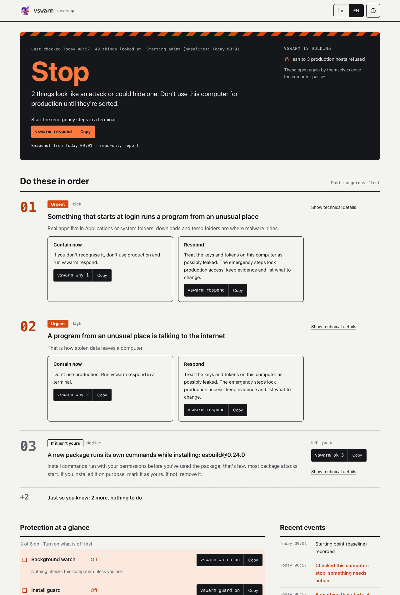

<p align="center">
  
</p>

<h1 align="center">vswarm</h1>

<p align="center"><b>Don't be the one who carries it in.</b><br>
Check your own machine before it touches production.</p>

<p align="center">
  <a href="https://github.com/kridsadar357/vswarm/actions/workflows/test.yml"></a>
  <a href="https://github.com/kridsadar357/vswarm/releases/latest"></a>
  <a href="LICENSE"></a>
  
  
  
  <a href="SECURITY.md#signed-releases"></a>
</p>

<p align="center">
  <a href="#install">Install</a> ·
  <a href="#what-using-it-looks-like">Use</a> ·
  <a href="#how-it-compares">Compare</a> ·
  <a href="docs/guide.md">Guide</a> ·
  <a href="README.th.md">ภาษาไทย</a>
</p>

> **Beta.** vswarm is young and still changing. Try it on a machine you can fix before you put it in front of your
> production access, and remove it with `vswarm uninstall`, not by deleting `~/.vswarm`
> ([why](#what-it-cant-do)). False alarms and rough edges: [tell us](https://github.com/kridsadar357/vswarm/issues/new/choose).

Your servers are patched, behind a VPN, with MFA on the console. They still let in anyone holding your ssh key or your
AWS session. So attackers stopped going for the server. They go for your laptop:

- a package called `axois` instead of `axios`
- a "take-home assignment" from a recruiter who does not exist
- an MCP server whose tool description quietly tells your AI agent to read `~/.ssh`
- a Homebrew tap that ships one extra binary

None of this needs an exploit. You run it yourself, it runs as you, and what it takes looks like you to the server.

vswarm is a free, local command line tool for macOS, Linux and Windows. It steps in at the few moments where that
happens: before an install, before running code you got from someone, before an AI tool gets a new server, and before
your machine is let near production.


<sub>A real run against `test/fixtures/fake-interview`, a harmless copy of the fake-interview repos used in real attacks.</sub>

## Without it, and with it

| What happens | Without vswarm | With vswarm |
| --- | --- | --- |
| You type `npm install axois` | Its install script runs as you before you see the typo | Stopped before anything runs: known malicious, "did you mean axios?" |
| A recruiter sends a repo to "fix a bug in" | `npm install` or just opening the folder in VS Code runs its loader. Your keys, browser passwords and wallets leave | `vswarm try` runs it on a copy with no access to your home or the network, then lists what it tried to take |
| You add an MCP server to Cursor or Claude Code | Its tool descriptions go straight to the model, hidden instructions included | Started in a sandbox first. Hidden instructions are shown to you, and the tools are pinned so a later change is caught |
| Something planted a login job last week | Nothing tells you. It runs at every login | The watch notices within seconds of the change, and `vswarm diff` shows it against your clean starting point |
| You `ssh prod-db` from that machine | The server sees a valid key and lets it in | Refused on the laptop, with the reason. With `vswarm agent` the key itself will not sign, even for `ssh -F /dev/null` |
| You find out you were hit | You guess what to rotate, and the evidence gets overwritten while you look | `vswarm respond` locks production access, keeps the evidence with hashes, and gives you the list of what to rotate |

## Should you use it?

Probably yes if:

- your laptop can reach production (ssh, AWS, kubectl, a database)
- you install npm, pip or brew packages most days
- you use AI coding agents with MCP servers
- you take repos from people you don't know: job hunting, freelancing, open source

Probably not if:

- your company already runs EDR plus device trust in its identity provider, and you never hold long-lived production
  credentials on the laptop. You are already covered better than a local tool can do it.
- the machine never touches anything you would mind losing

vswarm is not antivirus and not EDR. Malware that is already running as you can switch it off, and vswarm says so in
[SECURITY.md](SECURITY.md#what-vswarm-can-and-cannot-protect-against). What it is good at is the step before: making
sure the bad thing doesn't get in, and that a machine that looks wrong doesn't get your production keys.

## Install

```bash
# macOS / Linux
curl -fsSL https://raw.githubusercontent.com/kridsadar357/vswarm/main/install.sh | sh

# Windows 10/11 (PowerShell)
powershell -ExecutionPolicy Bypass -c "irm https://raw.githubusercontent.com/kridsadar357/vswarm/main/install.ps1 | iex"
```

Then open a new terminal and run:

```bash
vswarm setup
```

Setup checks the machine and walks you through each finding in one sentence. You fix it or tell vswarm it is yours.
Then it asks which of your ssh hosts are production, and offers the background watch and the install guard. Every
step can be skipped, and running it again only offers what is missing.

Requirements: git. The installer uses your [Bun](https://bun.sh) or installs a pinned release after checking its
SHA-256. On Linux, `vswarm try` also needs `sudo apt install bubblewrap strace`.

## What using it looks like

### Every day: you mostly don't notice it

Once setup is done there is nothing to run. The watch checks in the background, the guard sits in front of your
package manager, and the gate sits in front of ssh. `npm run dev` and `pip list` don't even start vswarm. You hear from
it when something changed, in plain words, with one command to deal with it:

```bash
vswarm scan        # Safe, Check this or Stop, then numbered findings
vswarm why 1       # why finding 1 matters and every way out
vswarm ok 1        # "that one is mine"
```


False alarms are treated as bugs. A tool that cries wolf gets uninstalled.

### Installing a package

With `vswarm guard on`, installs through npm, npx, pnpm, yarn, bun, pip, uv, pipx and brew are checked before the
package manager runs a single install script: known-malicious versions ([OSV](https://osv.dev)), names that look like
popular ones, brand-new packages with an install script, versions published in the last 48 hours, and what the
install script itself does.


Skip it once with `command npm …`. Check something without installing: `vswarm pkg check npm <name>`.

### Running code someone sent you

```bash
vswarm try ./assignment -- npm install
vswarm try https://github.com/someone/repo        # no command: a shell inside the sandbox
vswarm try ./repo --net registries -- npm ci      # let it reach package registries, nothing else
```

`try` reads the code first for things set up to run on their own (install scripts, VS Code tasks that run when the
folder opens, loaders hidden in `tailwind.config.js`). Then it runs it on a copy, in the operating system's sandbox:
no home folder, no keychain, a fake `HOME`, no network except through a proxy that records every host. At the end you
get what it tried.


Sandbox: Seatbelt on macOS, bubblewrap and strace on Linux, an AppContainer on Windows. On Windows, Node projects with
install scripts are better tried in WSL ([why](docs/guide.md#windows-preview)).

### Adding an AI tool server

`vswarm agents` lists the MCP servers, hooks and permission modes of Claude Code, Claude Desktop, Cursor, Windsurf,
VS Code, Gemini CLI and Codex. `--inspect` starts each server in the sandbox and reads what the model would read:


The tool definitions are pinned. If a server changes them later (a "rug pull"), the next scan says so.

### Going to production

```bash
vswarm gate ssh "prod-*"                  # ssh to these hosts checks the machine first
vswarm agent protect ~/.ssh/prod_key      # the key moves into an agent that signs only while the machine passes
vswarm gate aws prod-admin                # same for an AWS profile
vswarm gate kube prod                     # and a kube context
```

A check takes about 0.2 s and is reused for two minutes, so you don't feel it. When the machine does not pass:


The gate in `~/.ssh/config` can be bypassed by anything that ignores the config. That is why `vswarm agent` exists:
the key is no longer a file on disk, and the agent refuses to sign while the machine does not pass, whatever client
asks. There are also 15-minute SSH certificates (`vswarm ca`) if you'd rather have servers trust a CA instead of keys.

### When something got in

```bash
vswarm respond
```

It locks production access, copies the suspicious files with SHA-256 hashes, lists every credential to rotate
(from another device), asks before each cleanup step, and writes a report for your team and drafts for the package
registries. Nothing is sent anywhere.

<details>
<summary>Screenshot: vswarm respond</summary>


</details>

### For someone who doesn't read terminal output

`vswarm ui` opens a local page with one answer (Safe, Check this or Stop), the findings as cards that say why each
matters and what to do, and what is switched on. Thai or English, light or dark. `vswarm report --html` gives the
same view as a file to send, with credentials masked.



## How it compares

There are good tools in this space, and several do one part better than vswarm. The difference is mostly that vswarm
covers the developer's moments end to end, on one machine, without an account or a server.

| Tool | What it is great at | What it does not do that vswarm does | Pick it instead (or as well) when |
| --- | --- | --- | --- |
| [Socket Firewall](https://socket.dev) (`sfw`) | Blocking malicious packages, backed by Socket's analysis of the whole registry | Look at the rest of the machine, sandbox a repo, gate production | You want the strongest package check. vswarm hands installs to `sfw` when it is installed |
| [mcp-scan](https://github.com/invariantlabs-ai/mcp-scan) (Snyk) | Tool poisoning and rug-pull checks for MCP servers | Start the servers in a sandbox. Look at hooks, permission modes, or anything outside MCP | Your only worry is MCP |
| StepSecurity Dev Machine Guard | An inventory of extensions, packages and MCP servers across a company's laptops | Stop anything before it runs, or connect the result to production access | You need a fleet view and have their platform |
| Kolide (1Password Device Trust), Teleport Device Trust | Refusing the login on the server side when a device is unhealthy. Can't be bypassed from the laptop | Work without an identity provider and a subscription. Sandbox code, check installs | You run a company. This is the stronger control for production; vswarm's gate is the local version |
| osquery | Asking any question about any machine in SQL | Come with the questions answered: what to look for, what is normal, what to do | You have a security team to write and watch the queries |
| Objective-See BlockBlock, Santa | Persistence alerts as they happen (BlockBlock), binary allow-listing (Santa) on macOS | Cover Linux and Windows, packages, MCP or production access | You want macOS enforcement at the binary level |
| A throwaway VM or devcontainer | Real isolation for untrusted code | Tell you what the code tried to do | You want isolation and don't need the report. Use both for anything you really don't trust |
| EDR / antivirus (CrowdStrike, Defender …) | Known malware, behaviour on the whole OS, a team watching alerts | Know which of your actions is the risky one: the install, the repo, the MCP server, the ssh | Always, if your company provides it |

vswarm uses these where they are present: `sfw` for installs, and the server-side controls described in
[docs/server-side.md](docs/server-side.md).

## Does it actually catch things?

`vswarm selftest` builds a fake home, records a clean baseline, then plants harmless copies of real attack steps one at
a time (LaunchAgents, shell rc lines, systemd timers, LD_PRELOAD, ssh and git config tricks, package manager config,
kubectl and AWS helpers, editor and browser extensions, MCP configs, Windows Run keys, tasks and WMI …). It also plants
harmless look-alikes in the same places, to count false alarms:

```
detected 103/103 (100%) · benign look-alikes quiet 39/39 · false alarms 0
```

That covers the cases in [`src/sec/selftest-cases.ts`](src/sec/selftest-cases.ts), which we wrote, not every attack
there is. The look-alikes are ours too: "false alarms 0" means none on those 39, not none on your machine. A new
LaunchAgent or Homebrew tap that you added yourself is still reported, and a high one stops production access until
you mark it as yours (`vswarm ok <n>`). If you have seen a technique it misses, or it flagged something normal, a
selftest case is the most useful contribution you can make.

The package-name check alone, measured against every malicious npm and PyPI name in OSV: it stops 8.0% of PyPI's and
1.9% of npm's by name, with about 1% false positives. Most malicious packages have names that look like nothing, which
is why the guard also checks OSV, the package's age and downloads, and what its install script does. Details in
[the guide](docs/guide.md#13-measure-detection-selftest).

## Why this exists

vswarm started as a terminal board for watching AI coding agents work. Building it kept raising the same question:
a server can be hardened as much as you like, and it still trusts whoever holds a valid key. If the laptop holding
that key has picked up something it shouldn't have, nothing tells its owner before they connect.

So vswarm 2.0 changed its job to that: check your own machine before it touches production. Everything since
follows the ways attackers actually get onto developer machines.

The aim is a check that a solo developer or a small team will actually keep using: one command, plain words, quiet
unless it matters, honest about its limits, open source, and nothing sent anywhere.

**Where it is going**

- **Now:** Windows on par with macOS and Linux, beta testers on real machines, the Thai translation complete.
- **Next:** a menu-bar app for people who don't live in a terminal; more detection cases from real attacks,
  contributed by the community.
- **Later:** let servers decide from a signed verdict and short-lived certificates, so a small team gets
  device-aware access without buying a platform.

## Privacy

Everything stays on your machine, in `~/.vswarm`. No account, no telemetry. The network calls it makes: package names
and versions to `api.osv.dev`, and with the guard on, the package you are installing to its own registry. Credential
checks say where and what kind, never the value.

## Updates are signed

Releases are git tags signed with the maintainer's SSH key. The installer checks the signature, `vswarm install` pins
the key, and `vswarm update` only moves to newer tags signed by a pinned key. Someone who takes over the repository or
the GitHub account still can't push code to installed copies. Fingerprint, to compare with `vswarm trust`:

```
SHA256:icVOFCVDfJzfuqeKqZRicZ5TtRp0jZ4g5qfuA9PUe2g
```

## What it can't do

- Malware already running as you can turn vswarm off. vswarm seals its own state, so a hand-edited verdict is noticed,
  but the real fix for that case is on the server side ([docs/server-side.md](docs/server-side.md)).
- It won't see rootkits, firmware implants, or code that ran once and left nothing.
- A credential that was already stolen and is used from somewhere else is invisible to the laptop.
- A baseline taken on an infected machine treats the infection as normal.
- Windows is a preview: `ca`, `cert` and `canary` are not there yet, `respond` lists what to clean up instead of
  doing it, and `guard --sandbox` and the MCP sandbox (`agents --inspect`) are macOS and Linux only.
- **Remove it with `vswarm uninstall`.** Deleting `~/.vswarm` by hand leaves vswarm's blocks in `~/.ssh/config` and
  your shell rc. ssh to gated hosts then stops with "vswarm itself cannot run" until you reinstall or delete those
  blocks; installs carry on unchecked, with a warning. A key you moved into the agent is then only in
  `~/.ssh/<key>.vswarm-backup`, which `vswarm agent restore` opens with the recovery code you were given.

<details>
<summary>Everything it checks</summary>

| Area | What | Why |
|---|---|---|
| Homebrew | taps, formulae, casks; third-party taps | tampered formulae from unofficial taps |
| npm / bun globals, Python, Cargo | new packages, install scripts, look-alike names | install-time malware, typosquats |
| Known-malicious | exact versions against [OSV](https://osv.dev) `MAL-` records | packages already reported |
| Login jobs | LaunchAgents / LaunchDaemons, login items, crontab, systemd units, XDG autostart, Windows Run keys, tasks, services, WMI | persistence |
| System extensions | network / endpoint-security system extensions, kernel extensions (macOS), `/etc/ld.so.preload` (Linux) | traffic and file interception |
| Startup files | `.zshrc`, `.bashrc`, `.profile`, fish, PowerShell profiles, `.gitconfig`, `~/.ssh/config`, `authorized_keys`, `/etc/hosts` | persistence, backdoors, redirection |
| Package manager config | `~/.npmrc`, `pip.conf`, `uv.toml`, `.yarnrc.yml`, cargo config | every install or build redirected |
| Programs other tools run | kubeconfig exec plugins, AWS `credential_process`, Docker credential helpers, editor tasks, Python `.pth` hooks, global git hooks | code that runs with every CLI call |
| AI agents | MCP servers, hooks, `statusLine` commands, permission modes and plugins of Claude Code, Claude Desktop, Cursor, Windsurf, VS Code, Gemini CLI, Codex | agents run code with your access |
| Executables | new programs on PATH and their code signature | dropped binaries |
| Right now | programs running from temp/cache/hidden folders; unsigned programs holding outside connections | active implants |
| Credentials | SSH keys without a passphrase, AWS `AKIA` keys, static kube tokens, plain docker/gh/npm/pypi tokens, cloud token files, `.env` files | what a thief would take |
| Editors, browsers | VS Code / Cursor extensions and side-loaded ones; Chrome / Brave / Edge / Arc extensions and their permissions | extension malware |

</details>

<details>
<summary>All commands</summary>

```bash
vswarm setup                 # first run, and again whenever you like
vswarm scan · why · fix · ok # check, explain, fix, accept
vswarm baseline · diff       # "this is clean" · what changed since
vswarm watch on              # hourly, and within seconds of a change to a login job, rc file or agent config
vswarm secrets               # long-lived credentials on the machine (never prints values)
vswarm guard on · pkg        # check installs · check a package by hand
vswarm try                   # run untrusted code in a sandbox
vswarm agents [--inspect]    # AI agents and MCP servers
vswarm preflight · gate      # check before production · put that check in front of ssh, aws, kube, gcloud, az
vswarm agent                 # an ssh agent that signs only while the machine passes
vswarm ca · cert             # 15-minute SSH certificates
vswarm canary                # decoy credentials
vswarm respond · unlock      # when something is wrong · after it is clean
vswarm team                  # a signed policy shared through a git repo
vswarm ui · report           # dashboard · report to share
vswarm selftest              # measure detection
vswarm lang th               # Thai in the terminal and the dashboard
```

Each one is explained, with screenshots, in [the guide](docs/guide.md).

</details>

## Development

```bash
bun test            # unit and end-to-end tests, in sandbox homes
bunx tsc --noEmit
bun src/cli.ts selftest
```

## Contributing

The most useful contribution is a technique you have seen used against developers, turned into a selftest case: see
[CONTRIBUTING.md](CONTRIBUTING.md). False alarms are bugs; [report them](https://github.com/kridsadar357/vswarm/issues/new/choose).
Security issues go through [private reporting](SECURITY.md#reporting-a-vulnerability).

## License

Apache-2.0, see [LICENSE](LICENSE) and [NOTICE](NOTICE). You can fork it and ship your own version; the name and
the logo stay with the official project ([TRADEMARKS.md](TRADEMARKS.md)), and official releases are signed.
