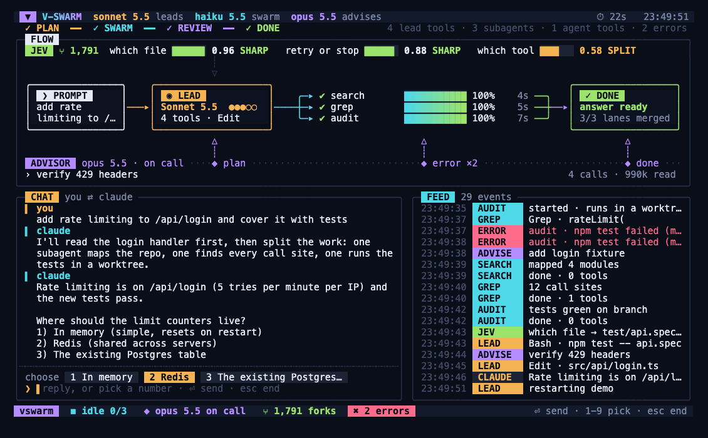

# V-SWARM

จอสดใน terminal สำหรับทำงานกับ Claude Code แสดงเส้นการทำงานทั้งหมด:
prompt → โมเดลหลัก (lead) → แตกงานให้ subagent หลายตัวพร้อมกัน → รวมผล → review
พร้อมการตัดสินใจของ Jev, คำแนะนำจาก advisor และช่องแชทสำหรับตอบคำถามที่ Claude ถามกลับ




## ติดตั้ง

**macOS / Linux**

```bash
curl -fsSL https://raw.githubusercontent.com/kridsadar357/vswarm/main/install.sh | sh
```

**Windows (PowerShell)**

```powershell
irm https://raw.githubusercontent.com/kridsadar357/vswarm/main/install.ps1 | iex
```

หรือ clone repo มาเองแล้วสั่ง install:

```bash
git clone https://github.com/kridsadar357/vswarm.git && cd vswarm
./vswarm install          # Windows: vswarm.cmd install
```

`vswarm install` จัดการให้ครบ:

- สร้าง `~/.vswarm` (config, ประวัติการรัน, Jev key)
- วางคำสั่ง `vswarm` ใน `~/.vswarm/bin` และเพิ่มเข้า PATH (`.zshrc` / `.bashrc` / fish / PATH ของ Windows)
- ติดตั้ง tab completion ของ zsh และ bash
- ถาม Jev API key (ข้ามได้)
- ถามว่าจะเปิด hook แบบ global ไหม เพื่อให้ `vswarm watch` เห็นทุก session ของ Claude Code
- ปิดท้ายด้วย `vswarm doctor` ตรวจว่าทุกอย่างพร้อม

ต้องมี [Bun](https://bun.sh) (ตัวติดตั้งลงให้ถ้ายังไม่มี), git และ [Claude Code](https://claude.com/claude-code) ที่ล็อกอินแล้ว

## ใช้งาน

```bash
vswarm                                  # เปิดจอ แล้วพิมพ์ prompt บนจอ
vswarm run "เพิ่ม rate limit ให้ /api/login พร้อม test"
vswarm "หาว่าใช้ auth ตรงไหนบ้าง"          # มีเว้นวรรค = run
vswarm run -p "สรุป README นี้"            # ไม่เปิดจอ พิมพ์คำตอบออกมา (ใช้ในสคริปต์)
```

### เมื่อ Claude ถามกลับ

session ไม่จบหลังตอบรอบเดียว Claude ถามอะไร คำถามขึ้นในช่อง **CHAT** แล้วพิมพ์ตอบได้เลย

- ถ้าคำถามมีตัวเลือกเป็นข้อ `1) ... 2) ...` จะขึ้นเป็นปุ่มด้านล่าง กดเลข `1`–`9` หรือ `↑` `↓` เพื่อเลือก แล้ว `⏎`
- พิมพ์ภาษาไทยได้ ลบทีละตัวอักษรรวมสระและวรรณยุกต์
- `esc` ระหว่างที่ Claude ทำงาน = หยุดรอบนั้น (session ยังอยู่ พิมพ์ต่อได้) · `esc` ตอนว่าง = จบ session · `ctrl-c` = ออกทันที
- จบแล้วคุยต่อทีหลังได้ด้วย `vswarm resume`

### ประวัติและการเล่นซ้ำ

```bash
vswarm history                 # รายการรันทั้งหมด ล่าสุดก่อน
vswarm replay 1 --speed 8      # เล่นรันล่าสุดบนจออีกครั้ง (space = หยุด/เล่น)
vswarm resume 1 "ต่อจากเมื่อกี้ เพิ่ม test อีก"
```

แต่ละรันเก็บไว้ที่ `~/.vswarm/runs/<id>/`: `events.jsonl` (ใช้ replay), `meta.json`, `answer.md`

### ดู session ปกติของ Claude Code

```bash
vswarm hooks on --global       # ทุก session ในเครื่อง
vswarm hooks on ~/develop/WMS  # เฉพาะโปรเจคนี้
vswarm watch                   # เปิดจอดู
vswarm hooks off --global
```

## ตั้งค่า

```bash
vswarm config                         # ดูค่าทั้งหมด
vswarm config lead opus               # โมเดลหลัก
vswarm config swarm haiku             # โมเดลของ subagent (off = ให้ lead เลือกเอง)
vswarm config advisor off             # ปิด advisor
vswarm config advisorAt plan,done     # จุดที่เรียก advisor: plan, error, done
vswarm config mode acceptEdits        # ให้แก้ไฟล์ได้โดยไม่ต้องถาม
vswarm config allow +Bash             # เพิ่ม tool ที่อนุญาต (-Bash เอาออก)
vswarm config jev                     # ใส่ Jev key (ไม่โชว์บนจอ)
```

ค่าเริ่มต้นแก้ไฟล์ไม่ได้ (mode `default`) ถ้า Claude ถูกบล็อกจะมีข้อความใน CHAT บอกว่าต้องเปิดอะไร
flag ต่อรัน: `--model` `--swarm` `--advisor` / `--no-advisor` `--mode` `--cwd` และ `-- <flag ของ claude>`

## คำสั่งอื่น

| คำสั่ง | ทำอะไร |
|---|---|
| `vswarm doctor` | ตรวจ bun, claude, git, PATH, config, Jev, hooks |
| `vswarm update` | `git pull` เวอร์ชันล่าสุด แล้วอัปเดต launcher, completion, hooks |
| `vswarm uninstall [--purge]` | เอา launcher, PATH, global hooks ออก (`--purge` ลบข้อมูลด้วย) |
| `vswarm demo` | จอตัวอย่าง ไม่เรียก API |
| `vswarm jev --q "<q>" --state "<ctx>" a b` | ถาม Jev ผลขึ้นบนจอ |
| `vswarm emit '<json>'` | ส่ง event อะไรก็ได้ขึ้นจอ |
| `vswarm completions zsh\|bash` | พิมพ์ completion script |
| `vswarm run --frames dir` + `bun scripts/frames.ts dir out.mp4` | อัดจอเป็นวิดีโอ |

## บนจอมีอะไร

- **แถบบน**: โมเดลที่ใช้, เวลา, ราง phase `PLAN → SWARM → REVIEW → DONE`
- **FLOW**: เส้นการทำงานจริง มีจุดวิ่งตามช่วงที่กำลังทำ
  - `PROMPT ─▸ LEAD ─┬▸ subagent แต่ละตัว ─┬─▸ REVIEW` เส้นของ subagent สว่างเมื่อส่งผลกลับแล้ว
  - ราง **JEV** ด้านบน ต่อเข้า LEAD: การตัดสินใจ retry/stop ตอน tool พัง ค่า ≥ 0.80 = SHARP ทำตามอัตโนมัติ
  - ราง **ADVISOR** ด้านล่าง มีจุดเสียบเข้า LEAD (ก่อนวางแผน), subagent (error ซ้ำ 2 ครั้ง), REVIEW (ก่อนจบ)
- **CHAT**: บทสนทนา คุณ ⇄ Claude และช่องตอบ
- **FEED**: ทุก event พร้อมป้ายสีตามที่มา
- จอปรับตามขนาด terminal ตั้งแต่ 120×36 ขึ้นไป

## โครงสร้าง

```
src/cli.ts      คำสั่งทั้งหมด
src/session.ts  vswarm run: session ต่อเนื่องผ่าน stream-json, แชท, ตอบคำถาม
src/setup.ts    install / doctor / update / uninstall / completion
src/view.ts     layout ของจอ
src/tui.ts      จอเต็ม, อ่านปุ่ม, แก้ข้อความภาษาไทย
src/state.ts    ชนิด event และการรวมเป็นสถานะ
src/hook.ts     แปลง payload ของ Claude Code hook เป็น event
src/hooks.ts    ใส่/ถอด hook ใน settings ของ Claude Code
src/brain.ts    advisor และ Jev ตอบกลับเข้า session ผ่าน hook
src/advisor.ts  เรียก advisor (claude -p)
src/jev.ts      เรียก Jev (typesafe.ai systemone)
src/history.ts  ประวัติการรัน
src/home.ts     ~/.vswarm และ config
src/screen.ts   ตาราง character → ANSI / HTML (รองรับภาษาไทย)
```

ทดสอบ `bun test` · ตรวจชนิด `bunx tsc --noEmit`
