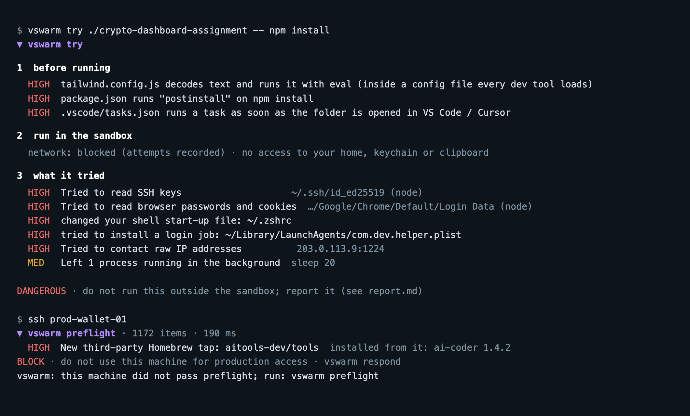

# vswarm

**Check your own machine before it touches production.**

Attackers increasingly go through the people who hold the keys: a tampered Homebrew package, a "coding
assignment" from a fake recruiter, a typo-squatted npm module. The malware runs as you, uses the credentials your
laptop remembers, and the server on the other end only sees a valid token.

vswarm sits in front of that last step. It keeps a record of what your machine looked like when it was clean, tells
you what changed, finds long-lived credentials that would be worth stealing, and refuses to hand out production
access (ssh, AWS, Kubernetes) from a machine that does not pass.

[ภาษาไทย](README.th.md)



<sub>Output from the test runs: `test/fixtures/fake-interview` (harmless imitation) and the selftest's planted Homebrew tap.</sub>

## Install

macOS and Linux. Needs [Bun](https://bun.sh) and git; on Linux, `vswarm try` also needs bubblewrap and strace
(`sudo apt install bubblewrap strace`).

```bash
curl -fsSL https://raw.githubusercontent.com/kridsadar357/vswarm/main/install.sh | sh
# or
git clone https://github.com/kridsadar357/vswarm.git && cd vswarm && ./vswarm install
```

## Use

```bash
vswarm scan                 # what is on this machine that deserves attention
vswarm baseline             # on a machine you trust: "this is clean"
vswarm diff                 # later: what changed since then
vswarm secrets              # long-lived credentials (never prints values)
vswarm selftest             # plant fake threats in a sandbox home, measure detection
```

### Gate production access

```bash
vswarm gate ssh "prod-*" "*.wallet.internal"     # adds a Match block to ~/.ssh/config (backup kept)
```

```ini
# ~/.aws/config
[profile prod]
credential_process = vswarm preflight --quiet --then aws configure export-credentials --profile prod-sso --format process
```

```yaml
# kubeconfig
users:
- name: prod-deployer
  user:
    exec:
      apiVersion: client.authentication.k8s.io/v1
      command: vswarm
      args: [preflight, --quiet, --then, kubelogin, get-token, --server-id, "<id>"]
```

`vswarm preflight` exits **0** on PASS and WARN, **3** on BLOCK (and **2** on WARN with `--strict`). A verdict is
reused for two minutes, so gating every `kubectl` call costs about 20 ms. A fresh check takes about 0.2 s.

### Short-lived SSH certificates

Servers trust a CA instead of keys. vswarm issues a fresh key with a 15-minute certificate, and only when the machine
passes preflight. A stolen key file is trusted nowhere, and a stolen certificate expires before it is worth much.

```bash
vswarm ca init                      # CA key protected by a passphrase you type at each signing (or: --sk, a hardware key touch)
vswarm ca server root               # prints the sshd commands to trust the CA; review them and run them on the server
vswarm gate ssh --cert prod-*       # ssh gets a certificate automatically when it connects
```

Tested end to end against a real `sshd`: the certificate logs in, the bare key is refused, an expired certificate is
refused, and no certificate is issued while preflight says BLOCK.

### Canary tokens

Decoy credentials placed where stealers look. Nobody has a reason to use them, so any use means the machine or a copy
of its files is in someone else's hands. Make the tokens at [canarytokens.org](https://canarytokens.org) (free, by
Thinkst) with your e-mail; vswarm plants and tracks them, and does not report your own decoys as exposure.

```bash
vswarm canary plant aws             # a decoy profile in ~/.aws/credentials
vswarm canary plant dns <token-host> # a decoy host at the top of ~/.ssh/config
vswarm canary plant env ~/develop/old-project
vswarm canary list · vswarm canary remove <id>
```

### AI agents and MCP servers

Coding agents run code with your access, and their settings decide what they may start on their own. `vswarm agents`
lists, and `scan` / `preflight` check, the MCP servers of Claude Code (every profile), Claude Desktop, Cursor,
Windsurf, VS Code, Gemini CLI and Codex, Claude Code hooks and `statusLine` commands, permission modes and plugins.

| Signal | Severity |
| --- | --- |
| MCP server or hook that downloads, decodes or backgrounds something, or runs from a temp/cache/hidden folder | high |
| MCP server started through npx/uvx with a look-alike package name | high |
| new or changed MCP server, new or changed hook, agent given more freedom (bypass, `Bash(*)`) since the baseline | medium |
| remote MCP server over plain http; token pasted into an MCP config | medium |

A baseline taken before vswarm checked agents does not report every existing server as new; it says the baseline
is older than the check, and `vswarm baseline` brings it up to date.

### Check packages before they install

Most stealers arrive as a package: a look-alike name, a hijacked release, a name an AI assistant made up and an
attacker then registered. `vswarm guard on` puts a thin wrapper around npm, npx, pnpm, yarn, bun, bunx, pip, pip3,
uv, uvx, pipx and brew in your shell. Installs are checked before the package manager runs any install script;
everything else (`npm run dev`, `pip list`) does not even start vswarm.

```
$ npm install axois
▼ vswarm checked npm axois · 412 ms
  CRIT  axois@0.0.1-security: known malicious
        OSV MAL-2025-15245
  HIGH  npm axois: looks like axios
        → did you mean axios?
  ? Stop here. Install anyway? [y/N]
```

| Signal | Severity |
| --- | --- |
| known-malicious version (OSV `MAL-`) | critical, blocks |
| one edit away from a popular name | high, blocks |
| no such package, but it looks like a popular one | high, blocks |
| package created in the last 30 days, few downloads, with an install script | high, blocks |
| version published in the last 48 hours | medium, warns |
| git URL, tarball, third-party Homebrew tap | medium, warns |
| install script on an established package | low, one line |

A bare `npm install` / `npm ci` checks every locked version against OSV. Blocking asks first; skip vswarm once with
`command npm …`, or turn it off with `vswarm guard off`. Check by hand without the wrapper:
`vswarm pkg npm install <name>`. If a registry cannot be reached, the install goes ahead with a notice.

### Run code you do not trust

A "take-home assignment" from a recruiter, a repo a stranger sent, an installer: run it in a sandbox first.

```bash
vswarm try ./assignment -- npm install          # or a git URL, a .zip, a single file
vswarm try https://github.com/someone/repo      # no command: a shell opens inside the sandbox
vswarm try ./repo --net registries -- npm ci    # allow package registries only
```

Before running, it reads the code for things built to run on their own: install scripts, VS Code tasks that run when
the folder opens, loaders hidden in `tailwind.config.js` / `next.config.js`, `eval(atob(…))`, raw IPs, references to
wallets and browser password stores. Then it runs the code on a **copy**, under the macOS sandbox:

- no access to your home folder (only your toolchains, read-only), keychain, clipboard, or other apps;
- a fake `HOME` and a clean environment (your tokens are not passed in);
- no network except localhost and a vswarm proxy that records every host it tries (`--net none` by default).

Afterwards it reports what the code **tried**: reading `~/.ssh`, browser passwords or wallets, planting login jobs or
shell lines, contacting outside hosts, leaving processes behind. Verdicts: DANGEROUS, SUSPICIOUS, NOTHING SEEN, or
INCONCLUSIVE when the command failed early.

```
3  what it tried
  HIGH  Tried to read SSH keys            ~/.ssh/id_ed25519 (node)
  HIGH  Tried to read browser passwords   ~/Library/Application Support/Google/Chrome/Default/Login Data (node)
  HIGH  tried to install a login job      ~/Library/LaunchAgents/com.dev.helper.plist
  HIGH  Tried to contact raw IP addresses 203.0.113.9:1224
DANGEROUS · do not run this outside the sandbox; report it (see report.md)
```

`test/fixtures/fake-interview` is a harmless imitation of a fake-interview repo used to test this.

### When something is wrong

```bash
vswarm respond      # 1 lock  2 evidence  3 credential checklist  4 contain  5 report
vswarm unlock       # after the machine is clean (best: reinstalled) and a new baseline is recorded
```

`respond` locks production access, copies the suspicious files with SHA-256 hashes, snapshots processes and
connections, lists every credential to rotate **from another device**, and asks before each change it would make
(unloading a login job, moving a binary to quarantine, removing added shell lines). It writes `report.md` /
`report.json` for your team, and OSV-format drafts for
[OpenSSF malicious-packages](https://github.com/ossf/malicious-packages) and the package registries. Nothing is sent
anywhere; you review and send.

## What it checks

| Area | What | Why |
|---|---|---|
| Homebrew | taps, formulae, casks; third-party taps | tampered formulae from unofficial taps |
| npm / bun globals, Python, Cargo | new packages, install scripts, look-alike names | install-time malware, typosquats |
| Known-malicious | exact versions against [OSV](https://osv.dev) `MAL-` records | packages already reported |
| Login jobs | LaunchAgents / LaunchDaemons, crontab | persistence |
| Startup files | `.zshrc`, `.bashrc`, `.profile`, `.gitconfig`, `~/.ssh/config`, `authorized_keys`, `/etc/hosts` | persistence, backdoors, redirection |
| Executables | new programs on PATH and their code signature | dropped binaries |
| Right now | programs running from temp/cache/hidden folders; who they talk to | active implants |
| Credentials | SSH keys without a passphrase, AWS `AKIA` keys, static kube tokens, plain docker/gh/npm/pypi tokens, `.env` files | what a thief would take |
| Editors, browsers | VS Code / Cursor extensions; Chrome / Brave / Edge / Arc extensions and their permissions | extension malware |

## Measured, not claimed

`vswarm selftest` builds a fake home, records a clean baseline, plants harmless stand-ins for real attack steps,
and prints what was caught:

```
detected 11/11 (100%) · false alarms on the clean parts: 0
```

That number covers the cases in [`src/sec/selftest.ts`](src/sec/selftest.ts), not every attack. Adding a case for
a technique you have seen is the most useful contribution you can make.

## Updates are signed

`vswarm update` installs only release tags signed by the release key pinned on your machine at install time, and
never an older version. If the repository or the maintainer's account is taken over, installed copies refuse the
attacker's release and keep running what they have. `vswarm trust` shows the pinned key; see [SECURITY.md](SECURITY.md).

## Privacy

- Everything stays on your machine, under `~/.vswarm/sec` with owner-only permissions. No telemetry.
- One network call: package **names and versions** to `api.osv.dev` for the known-malicious check, cached for a day.
  `--offline` skips it; the quiet gate (`preflight --quiet`) only uses the cache.
- With `vswarm guard on`, the names you install also go to the registry they come from (registry.npmjs.org,
  api.npmjs.org, api.deps.dev, pypi.org): the same names your package manager is about to send anyway.
- Credential checks report where and what kind, never the value.

## Linux

The same commands, with Linux's own places to hide:

| | macOS | Linux |
| --- | --- | --- |
| login jobs | LaunchAgents / LaunchDaemons | systemd units (user and system), XDG autostart |
| system-wide hooks | | `/etc/ld.so.preload` |
| running programs | `ps`, `lsof` | `/proc`, `ss` |
| `vswarm try` walls | Seatbelt (`sandbox-exec`) | bubblewrap: every home hidden, system read-only, `/run` hidden (Docker, D-Bus, keyring and agent sockets), own network and pid namespace |
| `vswarm try` record | the sandbox's deny log | strace: every path it tried and every address it tried to connect to |
| code signatures | `codesign` | not checked; new programs on PATH are reported as unverified |

Things that differ: on Linux the code's background processes end with the sandbox (reported as "detaches from the
terminal"); a hidden home is an empty writable folder, so writes there are recorded and thrown away. Ubuntu 24.04
limits user namespaces: `sudo sysctl kernel.apparmor_restrict_unprivileged_userns=0`, or give bwrap an AppArmor
profile. Inside Docker, run the container with `--security-opt seccomp=unconfined --security-opt apparmor=unconfined`.

## Limits

- It cannot see malware that hides well (rootkits, firmware) or code that ran once and left nothing behind.
- If a credential was already stolen and is used from the attacker's machine, nothing here sees it. What stops that
  is on the server side: short-lived credentials, hardware keys, device posture checks.
- On macOS, browser extensions need **Full Disk Access** for your terminal; without it vswarm says it could not
  check them instead of looking clean.
- A baseline taken on a machine that is already compromised treats the compromise as normal.

## Development

```bash
bun test            # unit + end-to-end tests (sandbox homes)
bunx tsc --noEmit
bun src/cli.ts selftest
```

See [CONTRIBUTING.md](CONTRIBUTING.md) and [SECURITY.md](SECURITY.md). Licensed under Apache-2.0.
