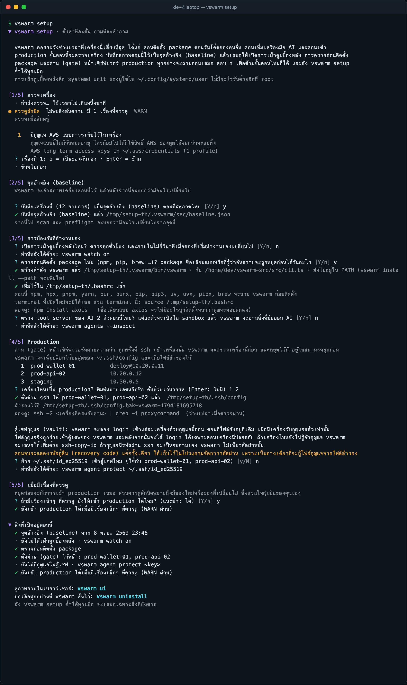

# vswarm (ภาษาไทย)

**อย่าให้เครื่องเราเป็นทางเข้าของผู้โจมตี**

server ทุกวันนี้แน่นหนาขึ้นมาก แต่ก็ยังเชื่อใครก็ตามที่ถือกุญแจถูกต้อง ผู้โจมตีจึงหันมาเล่นงาน developer กับโน้ตบุ๊กแทน
เช่น npm package ชื่อเลียนแบบ, "แบบทดสอบเขียนโค้ด" จากผู้สัมภาษณ์งานปลอม, MCP server ที่แอบใส่คำสั่ง, Homebrew tap ที่ถูกดัดแปลง
โค้ดอันตรายรันในนามของเรา ใช้สิ่งที่เครื่องจำไว้ แล้ว server ก็เห็นแค่ token ที่ถูกต้อง

vswarm จะเตือนและหยุดให้คิดก่อน ในจังหวะที่เสี่ยงจริงๆ ก่อนเรื่องจะใหญ่:
- **ตอนลง package** (`guard`) เช็คชื่อก่อนติดตั้ง: ชื่อเลียนแบบ, package อันตรายที่มีรายงานแล้ว, เวอร์ชันที่เพิ่งออก, สคริปต์ติดตั้ง
- **ตอนรันโค้ดของคนแปลกหน้า** (`try`) รันใน sandbox แล้วบอกว่ามันพยายามทำอะไร
- **ตอนเพิ่ม AI agent หรือ MCP server** (`agents --inspect`) เปิดใน sandbox แล้วอ่านสิ่งที่โมเดลจะได้อ่าน
- **ตอนจะเข้า production** (`preflight`, `gate`) ตรวจเครื่องก่อนที่ ssh, AWS หรือ kubectl จะได้ credential ไป

ทุกคำเตือนบอกว่าเสี่ยงเพราะอะไร และควรทำอะไรแทน นอกจังหวะเหล่านี้มันจะไม่กวน เพราะเครื่องมือที่เตือนพร่ำเพรื่อสุดท้ายก็โดนถอนทิ้ง
ใช้คำสั่งเดียวในเครื่อง ไม่ต้องมี server, MDM หรือ license รายหัว คนทำงานคนเดียวหรือทีมเล็กก็ใช้ได้จริง

vswarm **ไม่ใช่** EDR และไม่ใช่ระบบควบคุมสิทธิ์แบบปิดตาย ถ้ามี malware รันในนามเราอยู่แล้ว มันปิด vswarm ได้
vswarm ทำงานเสริมกับ Socket, osquery, EDR และ device trust (Teleport, Kolide) ไม่ได้มาแทน


**คู่มือฉบับเต็มพร้อมภาพ:** [docs/guide.th.md](docs/guide.th.md) · [English](docs/guide.md)

## ติดตั้ง

ใช้ได้ทั้ง macOS และ Linux ต้องมี git และ [Bun](https://bun.sh) (ตัวติดตั้งใช้ Bun ที่มีอยู่ หรือลง Bun รุ่นที่กำหนดไว้หลังตรวจ SHA-256) บน Linux ถ้าจะใช้ `vswarm try` ต้องลง bubblewrap และ strace ด้วย (`sudo apt install bubblewrap strace`) ส่วน Windows 10/11 มีรุ่นทดลองที่ตรวจเครื่องได้ (Run key, task, service, WMI, PowerShell profile …) พร้อม watch, ssh gate, install guard และ ssh agent ส่วน `try` รันใน AppContainer ซึ่งโปรเจกต์ Node ที่มีสคริปต์ติดตั้งควรลองใน WSL แทน ดู[Windows (รุ่นทดลอง)](docs/guide.th.md#windows-รุ่นทดลอง)

บน Linux vswarm ตรวจ systemd unit, XDG autostart, `/etc/ld.so.preload` และ process จาก `/proc`
- `vswarm try` ใช้ bubblewrap: ซ่อน home ทุกคน ซ่อน `/run` (socket ของ Docker, D-Bus, keyring) ระบบเป็นอ่านอย่างเดียว และมี network กับ pid ของตัวเอง
- strace บันทึกทุกไฟล์ที่โค้ดพยายามเปิด และทุกที่อยู่ที่พยายามต่อออกไป
- Ubuntu 24.04 จำกัด user namespace: `sudo sysctl kernel.apparmor_restrict_unprivileged_userns=0`

```bash
curl -fsSL https://raw.githubusercontent.com/kridsadar357/vswarm/main/install.sh | sh
```

จากนั้นมีขั้นเดียว เปิด terminal ใหม่แล้วสั่ง:

```bash
vswarm setup
```

ตั้งค่าทีละขั้น ถามทีละคำถาม: บอกก่อนว่าจะทำอะไร ตรวจเครื่องแล้วอธิบายแต่ละเรื่องในประโยคเดียว (แก้ให้ หรือยืนยันว่าเป็นของคุณ)
บันทึกจุดอ้างอิง (baseline) เสนอให้เปิดการเฝ้าดูเบื้องหลัง การตรวจก่อนติดตั้ง package และการตรวจ tool server ของ AI
ถามว่าเครื่องไหนใน `~/.ssh/config` เป็น production แล้วตั้งด่าน (gate) ไว้ให้ เสนอให้ย้ายกุญแจของเครื่องเหล่านั้นเข้าตู้เซฟ
(`agent protect` ซึ่งจะลองกุญแจกับเซิร์ฟเวอร์ก่อนเสมอ) และถามคำถามเรื่องนโยบายด้วยภาษาง่ายๆ ทุกขั้นข้ามได้
สั่งซ้ำเมื่อไรก็เสนอเฉพาะสิ่งที่ยังขาด `--yes` ใช้คำตอบที่แนะนำ (ไม่เลือกเครื่อง production และไม่ย้ายกุญแจแทนคุณ)
ถ้าไม่มี terminal ให้ถาม จะแสดงแผนอย่างเดียวโดยไม่เปลี่ยนอะไร บน macOS เมื่อเปิดการเฝ้าดู macOS จะขึ้นข้อความ
*Background Items Added: vswarm* ซึ่งเป็นเรื่องปกติ



ภาษา: `vswarm lang th` ให้ทั้ง terminal และ `vswarm ui` เป็นภาษาไทย (`en` อังกฤษ, `auto` ตามภาษาของระบบ)
ถ้าจะเปลี่ยนแค่ครั้งเดียวใช้ `VSWARM_LANG=th vswarm …` ชื่อคำสั่ง ตัวเลือก และ path ยังเป็นภาษาอังกฤษเหมือนเดิม
ส่วน `--json` ยังเป็นภาษาอังกฤษเสมอ เพื่อให้สคริปต์ใช้ต่อได้

ผลตรวจทุกคำสั่งใช้คำชุดเดียวกัน: **● ปลอดภัย**, **● ควรดูสักนิด** หรือ **● หยุดก่อน** ตามด้วยประโยคสั้นๆ
("ไม่พบสิ่งอันตราย มี 1 เรื่องที่ควรดู") แล้วแบ่งเรื่องที่เจอเป็น *ต้องจัดการ*, *ควรดู* และ *แค่ให้รู้*
แต่ละเรื่องมีหัวข้อภาษาง่ายๆ เหตุผลหนึ่งประโยค และคำสั่งเดียวที่ควรรัน (`vswarm fix 2`, `vswarm ok 2`)
ส่วนรายละเอียดทางเทคนิคดูได้ด้วย `--details` ป้าย PASS / WARN / BLOCK ยังอยู่ข้างๆ ให้สคริปต์และเอกสารใช้ต่อได้


## ใช้งาน

```bash
vswarm setup                         # เริ่มที่นี่: ตั้งค่าทุกอย่างทีละขั้น
vswarm lang th                       # ภาษาไทยทั้งใน terminal และหน้าภาพรวม (th, en หรือ auto)
vswarm why [n]                       # ทุกเรื่องที่เจอ: ทำไมถึงสำคัญ และคำสั่งที่ใช้แก้หรือยืนยันว่าเป็นของคุณ
vswarm fix 2 · vswarm ok 3           # แก้เรื่องที่ 2 (แสดงก่อนแล้วถาม) · ยืนยันว่าเรื่องที่ 3 เป็นของคุณ
vswarm scan                          # ตรวจตอนนี้
vswarm ui                            # หน้าสรุปแบบอ่านง่าย ภาษาไทย: ปลอดภัย / ควรดูสักนิด / หยุดก่อน (เครื่องนี้เท่านั้น)
vswarm baseline                      # บนเครื่องที่ไว้ใจ: บันทึกว่านี่คือสภาพสะอาด
vswarm diff                          # ทีหลัง: อะไรเปลี่ยนไปจาก baseline
vswarm secrets                       # credential อายุยาวในเครื่อง (ไม่แสดงค่า)
vswarm gate ssh "prod-*"             # ssh เข้า prod-* ได้เฉพาะตอนเครื่องผ่าน
vswarm gate aws prod-sso             # profile นี้ของ aws ได้ credential เฉพาะตอนเครื่องผ่าน (เก็บไฟล์ backup ไว้ --off คืนให้ตามเดิม)
vswarm gate kube prod                # context นี้ของ kubectl ขอ token ได้เฉพาะตอนเครื่องผ่าน
vswarm agent protect ~/.ssh/prod_key && vswarm agent on   # ย้ายกุญแจเข้า ssh agent ที่เซ็นให้เฉพาะตอนเครื่องผ่าน อ้อม config ก็ใช้กุญแจไม่ได้
vswarm gate gcloud prod --cred-file wif.json   # gcloud แบบ workload identity: คำสั่งขอ token รัน preflight ก่อน
vswarm gate cmd psql "*.prod.internal"         # ตัวเตือนก่อน psql, mysql, telnet … (ข้ามได้ด้วย command psql ไม่ใช่ตัวควบคุม)
vswarm respond                       # เจอของผิดปกติ: ล็อก เก็บหลักฐาน เปลี่ยน credential กักกัน รายงาน
vswarm selftest                      # ฝังภัยจำลอง 103 แบบใน home ปลอม วัดว่าจับได้กี่ข้อและแจ้งผิดกี่ครั้ง
vswarm watch on                      # ตรวจทุกชั่วโมง และภายในไม่กี่วินาทีเมื่อ login job, rc หรือ config ของ agent เปลี่ยน
vswarm try ./assignment -- npm install   # รันโค้ดที่ไม่ไว้ใจใน sandbox แล้วรายงานว่ามันพยายามทำอะไร
vswarm ca init && vswarm gate ssh --cert "prod-*"   # ใบรับรอง ssh อายุ 15 นาที ออกให้เมื่อเครื่องผ่านเท่านั้น
vswarm canary plant aws                  # วาง credential ล่อ ถ้ามีคนใช้จะได้ e-mail เตือน
vswarm guard on                          # npm, pip, brew … ถาม vswarm ก่อนติดตั้งทุกครั้ง
```

### vswarm agents: ตรวจ AI agent และ MCP

AI agent รันโค้ดด้วยสิทธิ์ของคุณ และการตั้งค่าเป็นตัวกำหนดว่ามันเริ่มอะไรเองได้บ้าง vswarm ตรวจ:
- MCP server ของ Claude Code (ทุก profile), Claude Desktop, Cursor, Windsurf, VS Code, Gemini CLI และ Codex
- hook และ `statusLine` ของ Claude Code, โหมด permission และ plugin

ระดับความรุนแรง:
- **สูง (หยุด):** MCP หรือ hook ที่ดาวน์โหลดแล้วรัน หรือรันจากโฟลเดอร์ชั่วคราว, MCP ที่ใช้ชื่อ package เลียนแบบ
- **กลาง (เตือน):** MCP server หรือ hook ที่เพิ่มหรือเปลี่ยนตั้งแต่ baseline, agent ได้สิทธิ์กว้างขึ้น, MCP ที่ต่อแบบ http ไม่เข้ารหัส, token ที่วางไว้ตรงๆ ใน config

ดูรายการทั้งหมดด้วย `vswarm agents`

### vswarm guard: ตรวจ package ก่อนติดตั้ง

`vswarm guard on` ครอบคำสั่ง npm, npx, pnpm, yarn, bun, bunx, pip, pip3, uv, uvx, pipx และ brew ใน shell
ตอนสั่งติดตั้ง vswarm จะตรวจก่อนที่สคริปต์ติดตั้งจะได้รัน ส่วนคำสั่งอื่น เช่น `npm run dev` ไม่ผ่าน vswarm เลย

- **หยุดและถามก่อน:** package ที่มีรายงานว่าอันตราย (OSV `MAL-`), ชื่อเลียนแบบ package ดัง (axois, reqeusts), ชื่อที่ไม่มีจริงแต่คล้ายของดัง, package ที่เพิ่งสร้างไม่ถึง 30 วัน มีคนโหลดน้อย และมีสคริปต์ติดตั้ง
- **เตือนแล้วไปต่อ:** เวอร์ชันที่เพิ่งออกไม่ถึง 48 ชั่วโมง (ช่วงที่ release ถูกแฮ็กมักโดนดึงออก), ติดตั้งจาก git URL หรือ tarball, Homebrew tap ของบุคคลที่สาม
- `npm install` เปล่าๆ จะเช็คทุกเวอร์ชันใน lockfile กับ OSV
- ข้าม vswarm ครั้งเดียวด้วย `command npm …` ปิดด้วย `vswarm guard off` ตรวจเองด้วย `vswarm pkg npm install <ชื่อ>`
- **เปิดดูข้างใน package** ก่อนติดตั้ง: โค้ดตอนติดตั้งที่ถอดรหัสแล้วรัน อ่าน credential ต่อเน็ต หรือฝังตัว และสิ่งที่เพิ่งโผล่มาเมื่อเทียบกับเวอร์ชันก่อน อ่านตัวเดียวโดยไม่ติดตั้งด้วย `vswarm pkg check npm <ชื่อ>`

### vswarm try: รันโค้ดที่ไม่ไว้ใจ

ใช้กับ "แบบทดสอบ" จากการสัมภาษณ์งาน, repo ที่คนแปลกหน้าส่งมา หรือ installer

- **ก่อนรัน:** อ่านโค้ดหาสิ่งที่ตั้งให้รันเอง เช่น install script, VS Code task ที่รันทันทีเมื่อเปิดโฟลเดอร์, ตัวโหลดที่ซ่อนใน config file, `eval(atob(…))`
- **ระหว่างรัน:** รันบนสำเนาใน sandbox ของ macOS
  - อ่าน home, keychain และ clipboard ไม่ได้
  - ใช้ HOME ปลอม ไม่ได้รับ token ของคุณ
  - ออกเน็ตไม่ได้ ทุก host ที่พยายามติดต่อถูกบันทึกไว้
- **รายงาน:** บอกว่ามันพยายามทำอะไร เช่น อ่าน `~/.ssh`, รหัสผ่านใน browser หรือ wallet, ฝัง login job, ต่อออกไปหา IP ภายนอก

```

ผล preflight: **PASS** ไปต่อ · **WARN** ไปต่อได้แต่ควรแก้ · **BLOCK** ไม่ปล่อย credential

### หน้าสรุป: vswarm ui

คำตอบตัวใหญ่ว่า **ปลอดภัย** **ควรดูสักนิด** หรือ **หยุดก่อน** พร้อมเหตุผล การ์ดของแต่ละเรื่องบอกว่าทำไมถึงสำคัญและควรทำอะไร
ความเคลื่อนไหวล่าสุด และสถานะการป้องกันแต่ละด้าน ทำมาให้คนที่ไม่ได้อ่านผลด้านความปลอดภัยเป็นประจำเข้าใจได้ทันที
จากหน้านี้กดตรวจใหม่และยืนยันว่าเรื่องไหนเป็นของคุณได้ ส่วนเรื่องอื่นยังทำใน terminal โดยหน้าเว็บแสดงคำสั่งให้คัดลอก
เปิดได้จากเครื่องนี้เท่านั้น และต้องใช้ลิงก์ที่มีกุญแจใช้ครั้งเดียว `vswarm report --html` เขียนหน้าเดียวกันเป็นไฟล์ไว้ส่งให้ทีม


## อัปเดตมีลายเซ็น

ตั้งแต่ v2.6.0 ทุก release เป็น git tag ที่ผู้ดูแลเซ็นด้วย SSH key ตัวติดตั้งจะตรวจลายเซ็นของ tag ล่าสุดก่อนติดตั้ง `vswarm install` จะจำกุญแจไว้ และหลังจากนั้น `vswarm update` จะยอมไปเฉพาะ tag ที่เซ็นด้วยกุญแจที่จำไว้ ไม่ถอยกลับไปเวอร์ชันเก่า ถ้า repo หรือบัญชีของผู้ดูแลถูกยึด ผู้โจมตีก็ส่งโค้ดเข้าเครื่องที่ติดตั้งไว้ไม่ได้ถ้าไม่มีกุญแจ ดูกุญแจที่จำไว้ด้วย `vswarm trust` แล้วเทียบกับ fingerprint ใน [SECURITY.md](SECURITY.md):

```
SHA256:icVOFCVDfJzfuqeKqZRicZ5TtRp0jZ4g5qfuA9PUe2g
```

ตัวติดตั้งไม่ได้ดึงสคริปต์จากเน็ตมารันเพื่อลง Bun: ใช้ Bun ที่มีอยู่ หรือดาวน์โหลด Bun รุ่นที่กำหนดไว้จาก GitHub แล้วติดตั้งเฉพาะเมื่อ SHA-256 ตรงกับค่าในสคริปต์

## ความเป็นส่วนตัว

- ข้อมูลอยู่ในเครื่องที่ `~/.vswarm/sec` เจ้าของเครื่องอ่านได้คนเดียว ไม่มี telemetry
- ส่งออกอย่างเดียว คือชื่อและเวอร์ชันของ package ไปที่ `api.osv.dev` เพื่อเช็คกับรายการ package อันตราย (ใช้ `--offline` เพื่อปิด)
- ถ้าเปิด `vswarm guard` ชื่อ package ที่กำลังจะติดตั้งจะถูกส่งไปถาม registry ต้นทางด้วย (เป็นชื่อเดียวกับที่ package manager กำลังจะส่งอยู่แล้ว)
- การตรวจ credential บอกแค่ตำแหน่งกับชนิด ไม่อ่านค่าออกมา

## ข้อจำกัด

- malware ที่รันในนามเราอยู่แล้วปิด vswarm ได้ vswarm ประทับตราไฟล์ของตัวเองด้วยกุญแจใน Keychain / Secret Service / DPAPI จึงจับการแก้ไฟล์ด้วยมือได้ แต่โปรแกรมที่รันในนามเราก็อ่านกุญแจนั้นได้เหมือนกัน การตัดสินใจที่ข้ามไม่ได้ควรอยู่ฝั่ง server ดู [docs/server-side.md](docs/server-side.md)
- จับ malware ที่ซ่อนตัวเก่ง หรือโค้ดที่รันครั้งเดียวแล้วไม่เหลือร่องรอยไม่ได้
- ถ้า credential ถูกขโมยไปแล้วและถูกใช้จากเครื่องผู้โจมตี vswarm มองไม่เห็น ต้องป้องกันฝั่ง server ด้วย credential อายุสั้น กุญแจฮาร์ดแวร์ และการตรวจสภาพเครื่อง
- บน macOS การตรวจ extension ของ browser ต้องให้สิทธิ์ Full Disk Access กับ terminal ถ้าไม่ให้ vswarm จะบอกว่าตรวจไม่ได้ ไม่ทำเหมือนว่าผ่าน
