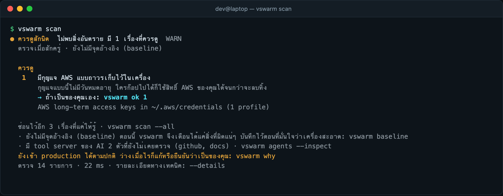
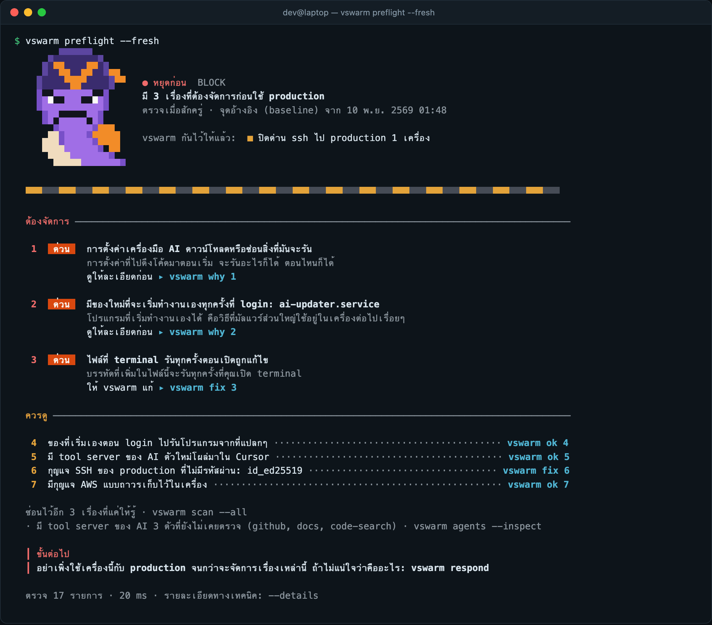
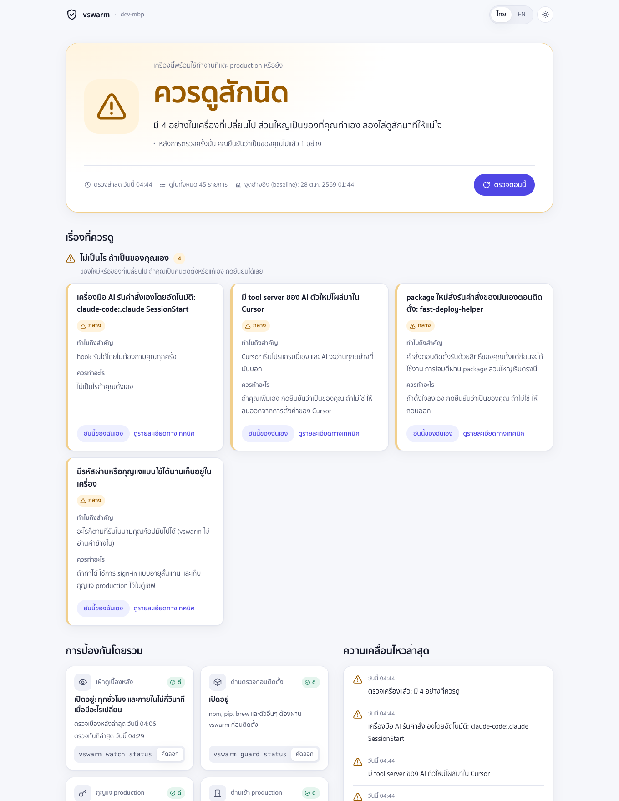

<p align="center">
  
</p>

<h1 align="center">vswarm</h1>

<p align="center"><b>อย่าให้เครื่องเราเป็นทางเข้าของผู้โจมตี</b><br>
ตรวจเครื่องตัวเองก่อนแตะ production</p>

<p align="center">
  <a href="https://github.com/kridsadar357/vswarm/actions/workflows/test.yml"></a>
  <a href="https://github.com/kridsadar357/vswarm/releases/latest"></a>
  <a href="LICENSE"></a>
  
  
  
  <a href="SECURITY.md#signed-releases"></a>
</p>

<p align="center">
  <a href="#ติดตั้ง">ติดตั้ง</a> ·
  <a href="#ใช้งานจริงหน้าตาเป็นยังไง">ใช้งาน</a> ·
  <a href="#เทียบกับเครื่องมืออื่น">เทียบ</a> ·
  <a href="docs/guide.th.md">คู่มือ</a> ·
  <a href="README.md">English</a>
</p>

> **Beta:** vswarm ยังใหม่และยังเปลี่ยนอยู่เรื่อยๆ ลองบนเครื่องที่แก้เองได้ก่อนจะเอาไปกั้นหน้า production และถ้าจะเอาออก
> ให้ใช้ `vswarm uninstall` อย่าลบ `~/.vswarm` เอง ([เหตุผล](#สิ่งที่ทำไม่ได้)) เจอการเตือนผิดหรือจุดที่ยังไม่ดี
> [บอกเราได้ที่นี่](https://github.com/kridsadar357/vswarm/issues/new/choose)

server สมัยนี้ลง patch ครบ อยู่หลัง VPN เปิด MFA ทุกอย่าง แต่ก็ยังยอมให้ใครก็ได้ที่ถือ ssh key หรือ session AWS ของเราเข้าไป
ผู้โจมตีเลยไม่เจาะ server แล้ว เขามาที่โน้ตบุ๊กของเราแทน:

- package ชื่อ `axois` ที่ตั้งใจให้พิมพ์ผิดจาก `axios`
- "แบบทดสอบก่อนสัมภาษณ์" จาก recruiter ที่ไม่มีตัวตน
- MCP server ที่ใน description ของ tool แอบสั่ง AI agent ให้ไปอ่าน `~/.ssh`
- Homebrew tap ที่แถม binary มาอีกตัว

ไม่ต้องมีช่องโหว่อะไรเลย เรารันเอง มันรันในนามเรา และของที่มันเอาไป server ก็เห็นเป็นตัวเราทุกอย่าง

vswarm เป็นเครื่องมือ command line ฟรี รันในเครื่อง ใช้ได้บน macOS, Linux และ Windows มันเข้ามาในไม่กี่จังหวะที่เรื่องแบบนี้เกิด:
ก่อนลง package, ก่อนรันโค้ดที่คนอื่นส่งมา, ก่อน AI tool ได้ server ตัวใหม่ และก่อนเครื่องจะได้เข้า production


<sub>ผลจากการรันจริงกับ `test/fixtures/fake-interview` ซึ่งเป็นของจำลองที่ไม่มีอันตราย เลียนแบบ repo สัมภาษณ์งานปลอมที่ใช้โจมตีกันจริง</sub>

## ไม่มี vswarm กับมี vswarm

| เหตุการณ์ | ไม่มี vswarm | มี vswarm |
| --- | --- | --- |
| พิมพ์ `npm install axois` | install script ของมันรันในนามเราไปแล้ว ก่อนเราจะเห็นว่าพิมพ์ผิด | หยุดก่อนอะไรจะรัน: เป็น package อันตรายที่มีรายงานแล้ว และถามว่า "หมายถึง axios หรือเปล่า?" |
| recruiter ส่ง repo มาให้ "ช่วยแก้บั๊ก" | แค่ `npm install` หรือเปิดโฟลเดอร์ใน VS Code ตัว loader ก็รันแล้ว key, รหัสผ่านใน browser และ wallet หลุดออกไป | `vswarm try` รันบนสำเนา เข้า home ไม่ได้ ออกเน็ตไม่ได้ แล้วบอกว่ามันพยายามเอาอะไรไปบ้าง |
| เพิ่ม MCP server ใน Cursor หรือ Claude Code | description ของ tool ไปถึงโมเดลตรงๆ รวมถึงคำสั่งที่ซ่อนไว้ด้วย | เปิดใน sandbox ก่อน คำสั่งที่ซ่อนไว้ถูกแสดงให้เห็น และจำ tool ไว้ ถ้าเปลี่ยนทีหลังจะรู้ |
| มีอะไรฝัง login job ไว้เมื่ออาทิตย์ก่อน | ไม่มีใครบอก มันรันทุกครั้งที่ login | watch เห็นภายในไม่กี่วินาทีหลังไฟล์เปลี่ยน และ `vswarm diff` ชี้ให้ดูเทียบกับตอนที่เครื่องยังสะอาด |
| `ssh prod-db` จากเครื่องนั้น | server เห็น key ถูกต้องก็ให้เข้า | ถูกปฏิเสธตั้งแต่ในเครื่อง พร้อมบอกเหตุผล ถ้าใช้ `vswarm agent` ตัว key เองจะไม่ยอมเซ็น ต่อให้ใช้ `ssh -F /dev/null` ก็ตาม |
| รู้ตัวว่าโดนแล้ว | เดาเอาว่าต้องเปลี่ยนรหัสอะไรบ้าง หลักฐานโดนทับไประหว่างที่ค้น | `vswarm respond` ล็อกการเข้า production เก็บหลักฐานพร้อม hash และให้รายการสิ่งที่ต้องเปลี่ยน |

## ควรใช้ไหม?

น่าจะควร ถ้า:

- โน้ตบุ๊กเข้า production ได้ (ssh, AWS, kubectl, database)
- ลง package จาก npm, pip หรือ brew แทบทุกวัน
- ใช้ AI coding agent กับ MCP server
- รับ repo จากคนที่ไม่รู้จัก เช่น ตอนหางาน, รับงาน freelance, ทำ open source

อาจไม่จำเป็น ถ้า:

- บริษัทมี EDR และ device trust ผูกกับ identity provider อยู่แล้ว และไม่เคยเก็บ credential production แบบอายุยาวไว้ในเครื่องเลย
  แบบนั้นป้องกันได้ดีกว่าเครื่องมือที่รันในเครื่องอยู่แล้ว
- เครื่องนั้นไม่ได้แตะอะไรที่เสียไปแล้วจะเดือดร้อน

vswarm ไม่ใช่ antivirus และไม่ใช่ EDR ถ้ามี malware รันในนามเราอยู่แล้ว มันปิด vswarm ได้ ซึ่งเขียนไว้ตรงๆ ใน
[SECURITY.md](SECURITY.md#what-vswarm-can-and-cannot-protect-against) สิ่งที่ vswarm ทำได้ดีคือขั้นก่อนหน้านั้น:
กันไม่ให้ของไม่ดีเข้ามา และไม่ให้เครื่องที่ดูผิดปกติได้ key ของ production ไป

## ติดตั้ง

```bash
# macOS / Linux
curl -fsSL https://raw.githubusercontent.com/kridsadar357/vswarm/main/install.sh | sh

# Windows 10/11 (PowerShell)
powershell -ExecutionPolicy Bypass -c "irm https://raw.githubusercontent.com/kridsadar357/vswarm/main/install.ps1 | iex"
```

แล้วเปิด terminal ใหม่ สั่ง:

```bash
vswarm setup
vswarm lang th      # ถ้าอยากให้ตอบเป็นภาษาไทย
```

setup จะตรวจเครื่องแล้วอธิบายทีละเรื่องสั้นๆ ให้เราแก้ หรือบอกว่า "อันนี้ของเราเอง" จากนั้นถามว่า host ไหนใน ssh config เป็น production
แล้วเสนอให้เปิด watch กับ install guard ทุกขั้นข้ามได้ สั่งซ้ำเมื่อไหร่ก็จะเสนอแค่ส่วนที่ยังขาด

ต้องมี git ตัวติดตั้งใช้ [Bun](https://bun.sh) ที่มีอยู่ หรือลงรุ่นที่กำหนดไว้หลังตรวจ SHA-256 บน Linux ถ้าจะใช้ `vswarm try`
ต้องลง `sudo apt install bubblewrap strace` ด้วย

## ใช้งานจริงหน้าตาเป็นยังไง

### วันปกติ: แทบไม่รู้สึกว่ามันอยู่

setup เสร็จแล้วก็ไม่ต้องสั่งอะไร watch ตรวจอยู่เบื้องหลัง guard ดักหน้า package manager และ gate ดักหน้า ssh ส่วน `npm run dev`
หรือ `pip list` ไม่ได้ปลุก vswarm ขึ้นมาเลย มันจะโผล่มาเฉพาะตอนมีอะไรเปลี่ยน บอกเป็นภาษาคน พร้อมคำสั่งเดียวที่ต้องใช้:

```bash
vswarm scan        # ปลอดภัย, ควรดูสักนิด หรือ หยุดก่อน ตามด้วยรายการที่มีเลขกำกับ
vswarm why 1       # ข้อ 1 สำคัญยังไง และมีทางไหนให้เลือกบ้าง
vswarm ok 1        # "ข้อนี้ของเราเอง"
```



ถ้าเตือนผิดเราถือเป็นบั๊ก เพราะเครื่องมือที่เตือนพร่ำเพรื่อสุดท้ายก็โดนถอนทิ้ง

### ตอนลง package

เปิด `vswarm guard on` แล้ว การติดตั้งผ่าน npm, npx, pnpm, yarn, bun, pip, uv, pipx และ brew จะถูกตรวจก่อนที่ install script
ตัวไหนจะได้รัน: เวอร์ชันที่มีรายงานว่าอันตราย ([OSV](https://osv.dev)), ชื่อที่คล้ายของดัง, package ใหม่เอี่ยมที่มี install script,
เวอร์ชันที่เพิ่งออกใน 48 ชั่วโมง และสิ่งที่ install script ทำจริงๆ


ข้ามครั้งเดียวด้วย `command npm …` อยากเช็คโดยไม่ติดตั้ง: `vswarm pkg check npm <ชื่อ>`

### ตอนรันโค้ดที่คนอื่นส่งมา

```bash
vswarm try ./assignment -- npm install
vswarm try https://github.com/someone/repo        # ไม่ใส่คำสั่ง: เปิด shell ใน sandbox ให้
vswarm try ./repo --net registries -- npm ci      # ให้ออกได้แค่ registry ของ package
```

`try` อ่านโค้ดก่อนว่ามีอะไรตั้งไว้ให้รันเอง (install script, task ของ VS Code ที่รันทันทีที่เปิดโฟลเดอร์, loader ที่ซ่อนใน
`tailwind.config.js`) แล้วค่อยรันบนสำเนาใน sandbox ของระบบปฏิบัติการ: ไม่มี home, ไม่มี keychain, `HOME` ปลอม,
ออกเน็ตได้แค่ผ่าน proxy ที่จดทุก host ไว้ จบแล้วจะได้รายการว่ามันพยายามทำอะไร


sandbox ที่ใช้: Seatbelt บน macOS, bubblewrap กับ strace บน Linux, AppContainer บน Windows ส่วนโปรเจกต์ Node ที่มี install script
บน Windows ลองใน WSL จะเห็นครบกว่า ([เหตุผล](docs/guide.th.md#windows-รุ่นทดลอง))

### ตอนเพิ่ม AI tool server

`vswarm agents` แสดง MCP server, hook และโหมดสิทธิ์ของ Claude Code, Claude Desktop, Cursor, Windsurf, VS Code, Gemini CLI และ Codex
ส่วน `--inspect` จะเปิดแต่ละ server ใน sandbox แล้วอ่านสิ่งที่โมเดลจะได้อ่าน:


นิยามของ tool ถูกจำไว้ ถ้า server เปลี่ยนทีหลัง (rug pull) scan ครั้งถัดไปจะบอก

### ตอนจะเข้า production

```bash
vswarm gate ssh "prod-*"                  # ssh ไป host เหล่านี้ต้องผ่านการตรวจเครื่องก่อน
vswarm agent protect ~/.ssh/prod_key      # ย้าย key เข้า agent ที่ยอมเซ็นเฉพาะตอนเครื่องผ่าน
vswarm gate aws prod-admin                # แบบเดียวกันสำหรับ AWS profile
vswarm gate kube prod                     # และ kube context
```

ตรวจครั้งหนึ่งราว 0.2 วินาที และใช้ผลซ้ำได้ 2 นาที เลยไม่รู้สึกช้า ถ้าเครื่องไม่ผ่าน:



gate ใน `~/.ssh/config` ยังเลี่ยงได้ถ้าโปรแกรมไม่อ่าน config นั้น จึงมี `vswarm agent`: key ไม่ได้เป็นไฟล์ในเครื่องอีกต่อไป และ agent
ไม่ยอมเซ็นตราบที่เครื่องยังไม่ผ่าน ไม่ว่า client ไหนจะขอ ถ้าอยากให้ server เชื่อ CA แทน key ก็มี SSH certificate อายุ 15 นาที (`vswarm ca`)

### ตอนรู้ว่าโดนแล้ว

```bash
vswarm respond
```

ล็อกการเข้า production, เก็บไฟล์ที่น่าสงสัยพร้อม SHA-256, ให้รายการ credential ที่ต้องเปลี่ยน (ทำจากเครื่องอื่น), ถามก่อนทุกขั้นที่จะลบหรือย้ายอะไร
แล้วเขียนรายงานให้ทีม และร่างรายงานส่ง registry ของ package ไม่มีอะไรถูกส่งออกไปเอง

<details>
<summary>ภาพ: vswarm respond</summary>


</details>

### สำหรับคนที่ไม่อ่าน output ใน terminal

`vswarm ui` เปิดหน้าเว็บในเครื่อง มีคำตอบเดียวตัวใหญ่ (ปลอดภัย, ควรดูสักนิด หรือ หยุดก่อน) รายการเป็นการ์ดที่บอกว่าทำไมสำคัญและต้องทำอะไร
และดูได้ว่าเปิดการป้องกันอะไรไว้บ้าง มีทั้งไทยและอังกฤษ โหมดสว่างและมืด ส่วน `vswarm report --html` ได้หน้าเดียวกันเป็นไฟล์ไว้ส่งต่อ
โดยปิด credential ไว้ให้แล้ว



## เทียบกับเครื่องมืออื่น

เครื่องมือในกลุ่มนี้มีของดีหลายตัว และบางตัวทำบางส่วนได้ดีกว่า vswarm ด้วย ความต่างหลักคือ vswarm ครอบทุกจังหวะของ developer
ตั้งแต่ต้นจนจบ ในเครื่องเดียว ไม่ต้องมีบัญชีหรือ server

| เครื่องมือ | เก่งเรื่อง | สิ่งที่ไม่ได้ทำ แต่ vswarm ทำ | ควรใช้ตัวนั้นแทน (หรือใช้ด้วย) เมื่อ |
| --- | --- | --- | --- |
| [Socket Firewall](https://socket.dev) (`sfw`) | บล็อก package อันตราย โดยมีข้อมูลวิเคราะห์ทั้ง registry ของ Socket หนุนหลัง | ตรวจส่วนอื่นของเครื่อง, รัน repo ใน sandbox, กั้น production | อยากได้การตรวจ package ที่แรงที่สุด ถ้าลง `sfw` ไว้ vswarm จะส่งการติดตั้งไปผ่านมันด้วย |
| [mcp-scan](https://github.com/invariantlabs-ai/mcp-scan) (Snyk) | ตรวจ tool poisoning และ rug pull ของ MCP server | เปิด server ใน sandbox, ตรวจ hook, โหมดสิทธิ์ หรืออะไรที่อยู่นอก MCP | ห่วงแค่เรื่อง MCP อย่างเดียว |
| StepSecurity Dev Machine Guard | ทำบัญชี extension, package และ MCP server ของโน้ตบุ๊กทั้งบริษัท | หยุดของก่อนมันรัน หรือผูกผลตรวจเข้ากับสิทธิ์เข้า production | ต้องการภาพรวมทั้งองค์กร และใช้ platform ของเขาอยู่ |
| Kolide (1Password Device Trust), Teleport Device Trust | ปฏิเสธการ login ตั้งแต่ฝั่ง server เมื่อเครื่องไม่ปกติ เลี่ยงจากโน้ตบุ๊กไม่ได้ | ใช้ได้โดยไม่ต้องมี identity provider และค่าสมาชิก, รันโค้ดใน sandbox, ตรวจการติดตั้ง | เป็นบริษัท อันนี้คุม production ได้แน่นกว่า ส่วน gate ของ vswarm คือรุ่นที่ทำในเครื่อง |
| osquery | ถามอะไรก็ได้เกี่ยวกับเครื่องไหนก็ได้ด้วย SQL | มีคำตอบสำเร็จรูปให้เลย: ต้องดูอะไร อะไรปกติ ต้องทำอะไรต่อ | มีทีม security คอยเขียนและเฝ้า query |
| Objective-See BlockBlock, Santa | เตือน persistence ทันทีที่เกิด (BlockBlock) และ allow-list ระดับ binary (Santa) บน macOS | ครอบ Linux กับ Windows, package, MCP หรือการเข้า production | อยากบังคับระดับ binary บน macOS |
| VM ทิ้งได้ หรือ devcontainer | แยกโค้ดที่ไม่ไว้ใจได้จริง | บอกว่าโค้ดพยายามทำอะไร | ต้องการแค่แยก ไม่ต้องการรายงาน ถ้าไม่ไว้ใจจริงๆ ใช้ทั้งคู่ |
| EDR / antivirus (CrowdStrike, Defender …) | malware ที่รู้จัก, พฤติกรรมทั้งระบบ, มีทีมเฝ้า alert | รู้ว่าจังหวะไหนของเราคือจังหวะเสี่ยง: ตอนลง package, ตอนรัน repo, ตอนเพิ่ม MCP server, ตอน ssh | ใช้เสมอถ้าบริษัทมีให้ |

ถ้ามีเครื่องมือเหล่านี้อยู่ vswarm ก็ใช้ร่วมด้วย เช่น ส่งการติดตั้งไปผ่าน `sfw` และแนวทางฝั่ง server ใน [docs/server-side.md](docs/server-side.md)

## จับได้จริงไหม?

`vswarm selftest` สร้าง home ปลอม บันทึกจุดเริ่มต้นที่สะอาด แล้วฝังของจำลองเทคนิคโจมตีจริงทีละอย่าง (LaunchAgent, บรรทัดใน shell rc,
systemd timer, LD_PRELOAD, ลูกเล่นใน ssh และ git config, config ของ package manager, helper ของ kubectl และ AWS, extension ของ editor
และ browser, config ของ MCP, Run key, task และ WMI ของ Windows …) และฝังของหน้าตาคล้ายแต่ไม่อันตรายไว้ที่เดียวกัน เพื่อนับการเตือนผิด:

```
detected 103/103 (100%) · benign look-alikes quiet 39/39 · false alarms 0
```

ตัวเลขนี้นับเฉพาะกรณีใน [`src/sec/selftest-cases.ts`](src/sec/selftest-cases.ts) ที่เราเขียนเอง ไม่ใช่ทุกการโจมตีที่มีในโลก
ของหน้าตาคล้ายก็เราเขียนเองเหมือนกัน "false alarms 0" จึงหมายถึงไม่เตือนผิดใน 39 กรณีนั้น ไม่ได้แปลว่าเครื่องคุณจะไม่โดนเตือนผิดเลย
LaunchAgent หรือ Homebrew tap ใหม่ที่คุณลงเองก็ยังถูกแจ้ง และถ้าระดับสูงจะกั้นการเข้า production จนกว่าจะยืนยันว่าเป็นของคุณ (`vswarm ok <เลข>`)
ถ้าเคยเจอเทคนิคที่มันจับไม่ได้ หรือมันเตือนของปกติ การเพิ่มกรณีทดสอบคือการช่วยที่มีค่าที่สุด

ส่วนการตรวจชื่อ package อย่างเดียว วัดกับชื่อ package อันตรายทั้งหมดของ npm และ PyPI ใน OSV: ดูจากชื่ออย่างเดียวหยุดได้ 8.0% ของ PyPI
และ 1.9% ของ npm โดยเตือนผิดราว 1% package อันตรายส่วนใหญ่ชื่อไม่คล้ายอะไรเลย guard จึงเช็ค OSV, อายุ, ยอดดาวน์โหลด และสิ่งที่ install
script ทำด้วย รายละเอียดใน[คู่มือ](docs/guide.th.md#13-วัดผลการตรวจจับ-selftest)

## ทำไมถึงมี vswarm

vswarm เริ่มจากการเป็นกระดานใน terminal ไว้ดู AI agent ทำงาน ระหว่างทำมีคำถามหนึ่งวนกลับมาตลอด: server จะป้องกันแน่นแค่ไหน
ก็ยังเชื่อคนที่ถือ key ถูกต้อง ถ้าเครื่องที่ถือ key มีของแปลกปลอม ก็ไม่มีอะไรบอกเจ้าของเครื่องก่อนเขาจะเชื่อมต่อเลย

vswarm จึงเปลี่ยนหน้าที่มาเป็นแบบนั้น: ตรวจเครื่องตัวเองก่อนแตะ production ส่วนที่เพิ่มหลังจากนั้นทั้งหมดมาจากช่องทางที่ผู้โจมตีใช้เข้าเครื่อง developer จริง

เป้าหมายคือด่านตรวจที่คนทำงานคนเดียวหรือทีมเล็กจะใช้ต่อไปจริงๆ: คำสั่งเดียว พูดภาษาคน เงียบจนกว่าจะมีเรื่อง บอกตรงๆ ว่าทำอะไรไม่ได้
เป็นโอเพนซอร์ส และไม่ส่งอะไรออกไป

**จะไปทางไหนต่อ**

- **ตอนนี้:** Windows ทำได้เท่า macOS และ Linux, หาผู้ทดสอบ beta บนเครื่องจริง, แปลไทยให้ครบ
- **ถัดไป:** แอปบน menu bar สำหรับคนที่ไม่ได้อยู่ใน terminal, กรณีทดสอบจากการโจมตีจริงที่ชุมชนช่วยกันเพิ่ม
- **ระยะยาว:** ให้ server ตัดสินใจจากผลตรวจที่มีลายเซ็นและ certificate อายุสั้น ทีมเล็กจะได้คุมการเข้าถึงตามสภาพเครื่องโดยไม่ต้องซื้อ platform

## ความเป็นส่วนตัว

ทุกอย่างอยู่ในเครื่อง ใน `~/.vswarm` ไม่มีบัญชี ไม่มี telemetry สิ่งที่ส่งออกเน็ต: ชื่อและเวอร์ชันของ package ไปที่ `api.osv.dev`
และถ้าเปิด guard ก็ส่งชื่อ package ที่กำลังลงไปที่ registry ของมันเอง การตรวจ credential บอกแค่ว่าอยู่ที่ไหนและเป็นชนิดอะไร ไม่เคยแสดงค่า

## อัปเดตมีลายเซ็น

ทุก release เป็น git tag ที่เซ็นด้วย SSH key ของผู้ดูแล ตัวติดตั้งตรวจลายเซ็น `vswarm install` จำ key ไว้ และ `vswarm update`
ยอมไปแค่ tag ใหม่กว่าที่เซ็นด้วย key ที่จำไว้ ต่อให้ใครยึด repository หรือบัญชี GitHub ได้ ก็ส่งโค้ดเข้าเครื่องที่ติดตั้งแล้วไม่ได้
fingerprint สำหรับเทียบกับ `vswarm trust`:

```
SHA256:icVOFCVDfJzfuqeKqZRicZ5TtRp0jZ4g5qfuA9PUe2g
```

## สิ่งที่ทำไม่ได้

- malware ที่รันในนามเราอยู่แล้วปิด vswarm ได้ vswarm ผนึกสถานะของตัวเองไว้ ถ้ามีคนแก้ผลตรวจด้วยมือจะรู้ แต่ทางแก้จริงของกรณีนี้อยู่ฝั่ง server
  ([docs/server-side.md](docs/server-side.md))
- มองไม่เห็น rootkit, ของที่ฝังใน firmware หรือโค้ดที่รันครั้งเดียวแล้วไม่ทิ้งร่องรอย
- credential ที่ถูกขโมยไปแล้วและถูกใช้จากที่อื่น โน้ตบุ๊กมองไม่เห็น
- ถ้าบันทึก baseline ตอนเครื่องติดอยู่แล้ว สิ่งที่ติดจะถูกนับเป็นเรื่องปกติ
- Windows ยังเป็นรุ่นทดลอง: ยังไม่มี `ca`, `cert` และ `canary`, `respond` บอกรายการที่ต้องเก็บกวาดแต่ไม่ลงมือเอง และ
  `guard --sandbox` กับ sandbox ของ MCP (`agents --inspect`) มีแค่บน macOS กับ Linux
- **เอาออกด้วย `vswarm uninstall` เท่านั้น** ถ้าลบ `~/.vswarm` เอง บล็อกของ vswarm จะค้างอยู่ใน `~/.ssh/config` และ shell rc
  ssh ไป host ที่ตั้งด่านไว้จะหยุดพร้อมข้อความ "vswarm itself cannot run" จนกว่าจะติดตั้งใหม่หรือลบบล็อกนั้น ส่วนการลง package
  จะทำต่อได้แต่ไม่ถูกตรวจและมีคำเตือน key ที่ย้ายเข้า agent ไว้จะเหลือแค่ใน `~/.ssh/<key>.vswarm-backup` ซึ่งเปิดได้ด้วย
  `vswarm agent restore` กับ recovery code ที่ได้ตอนย้าย

<details>
<summary>ทุกคำสั่ง</summary>

```bash
vswarm setup                 # ครั้งแรก และสั่งซ้ำได้ตลอด
vswarm scan · why · fix · ok # ตรวจ, อธิบาย, แก้, ยอมรับ
vswarm baseline · diff       # "ตอนนี้สะอาด" · อะไรเปลี่ยนไปตั้งแต่นั้น
vswarm watch on              # ทุกชั่วโมง และภายในไม่กี่วินาทีเมื่อ login job, rc file หรือ config ของ agent เปลี่ยน
vswarm secrets               # credential อายุยาวในเครื่อง (ไม่แสดงค่า)
vswarm guard on · pkg        # ตรวจการติดตั้ง · ตรวจ package ด้วยมือ
vswarm try                   # รันโค้ดที่ไม่ไว้ใจใน sandbox
vswarm agents [--inspect]    # AI agent และ MCP server
vswarm preflight · gate      # ตรวจก่อนเข้า production · ตั้งด่านหน้า ssh, aws, kube, gcloud, az
vswarm agent                 # ssh agent ที่เซ็นเฉพาะตอนเครื่องผ่าน
vswarm ca · cert             # SSH certificate อายุ 15 นาที
vswarm canary                # credential ล่อ
vswarm respond · unlock      # เมื่อมีเรื่อง · หลังเครื่องสะอาดแล้ว
vswarm team                  # policy ที่เซ็นแล้ว แชร์ผ่าน git repo
vswarm ui · report           # dashboard · รายงานไว้ส่งต่อ
vswarm selftest              # วัดผลการตรวจจับ
vswarm lang th               # ภาษาไทยทั้งใน terminal และ dashboard
```

ทุกคำสั่งมีคำอธิบายพร้อมภาพใน[คู่มือ](docs/guide.th.md)

</details>

## พัฒนา

```bash
bun test            # unit และ end-to-end test ใน home จำลอง
bunx tsc --noEmit
bun src/cli.ts selftest
```

## ร่วมพัฒนา

สิ่งที่ช่วยได้มากที่สุดคือเทคนิคโจมตีที่เคยเห็นใช้กับ developer แปลงเป็นกรณีทดสอบใน selftest ดู [CONTRIBUTING.md](CONTRIBUTING.md)
การเตือนผิดถือเป็นบั๊ก [แจ้งได้ที่นี่](https://github.com/kridsadar357/vswarm/issues/new/choose) ส่วนช่องโหว่ให้แจ้งแบบ
[ส่วนตัว](SECURITY.md#reporting-a-vulnerability)

## สัญญาอนุญาต

Apache-2.0 ดู [LICENSE](LICENSE) และ [NOTICE](NOTICE) จะ fork ไปทำเวอร์ชันของตัวเองก็ได้ แต่ชื่อและโลโก้เป็นของโปรเจกต์ทางการ
([TRADEMARKS.md](TRADEMARKS.md)) และ release ทางการมีลายเซ็นเสมอ
